# Walkthrough: PDF Editor Pro — Công cụ nhanh & Tính năng nâng cao

Tài liệu này mô tả bản nâng cấp "Pro": thiết kế (mockup), luồng xử lý (Mermaid), các module mới, rủi ro và cách kiểm thử.

## 1. Phạm vi

| Nhóm | Tính năng | Ghi chú |
|---|---|---|
| Công cụ nhanh | Màn hình khởi động với lưới công cụ nhanh | Hiện khi chưa mở tệp; bấm một công cụ cần tệp sẽ hỏi chọn PDF rồi chạy luôn |
| | Hộp thoại **Công cụ nhanh** (Tệp › Công cụ nhanh, Trợ giúp, Ctrl+K) | Cùng lưới công cụ, dùng khi đang mở tài liệu |
| | Gộp nhiều PDF | Danh sách tệp, đổi thứ tự, đặt tài liệu đang mở lên đầu, gộp rồi mở hoặc tải về |
| | Tách PDF | Mỗi trang / mỗi N trang / theo phần tự chọn `1-3; 4-6; 7-`, nhiều phần đóng gói .zip |
| | Đánh số trang | Vị trí, mẫu, số bắt đầu, bỏ qua trang bìa |
| | Gỡ mật khẩu | Mở tệp có mật khẩu hoặc hạn chế quyền và tải bản không khóa |
| | Đóng tài liệu | Tệp › Đóng tài liệu, quay về màn hình khởi động |
| Nâng cao | Cắt lề trang | Lề cố định (mm) hoặc tự động theo nội dung từng trang, xem trước trực tiếp trên trang; các mục giữ đúng chỗ |
| | Mục lục (bookmark) | Tab **Mục lục** ở bảng bên phải, bấm để nhảy đến đúng trang và độ cao |
| | Font tiếng Việt tự động | Tự tải DejaVu Sans khi cần, chỉ lần đầu, cho xuất PDF (kể cả lớp chữ OCR), Word→PDF, Excel→PDF |
| | Word→PDF | Giữ tiêu đề, đoạn (ngắt dòng theo độ rộng thật), danh sách có dấu/đánh số, bảng |
| | Excel→PDF | Mọi sheet, độ rộng cột theo nội dung, bảng rộng tự xoay ngang, lặp dòng tiêu đề, số canh phải |
| Giao diện | White theme theo CLAUDE.md | `#ffffff`, `#f8fafc`, `#f4f4f5`, viền `#e4e4e7`, bo góc 8–12px; thêm tên token của kế hoạch (`--surface-card`…) |

Các tính năng sau có trong bản này nhưng do phiên làm việc song song xây trong `src/components/` (giai đoạn 3–4 của `pdf_editor_completion_plan.md`). Chúng dùng các hàm của đợt này: `moveSelectionOrder`, `remapOrder`, `isIdentityOrder` (`pages.js`), `reorderPages` (`pdfops.js`), `snapLines`/`snapRect` (`snap.js`).

- Kéo-thả sắp xếp trang, chọn nhiều trang (Ctrl/Shift), nút xoay/xóa nhanh trên từng hình thu nhỏ.
- Cuộn bằng Space+kéo, chuột giữa, công cụ Bàn tay (H), vuốt; Ctrl+lăn hoặc chụm hai ngón để phóng to tại con trỏ.
- Bắt dính khi kéo mục (giữ Ctrl để tắt), vẽ trang lười và giải phóng trang ở xa.

Sửa lỗi kèm theo:

- Word→PDF, Excel→PDF và con dấu "ĐÃ DUYỆT" báo lỗi WinAnsi khi chưa chọn font (Helvetica không có chữ tiếng Việt). Nay tự tải font, hoặc bỏ dấu thay vì lỗi khi mất mạng.
- `LIB_URLS.xlsx` trỏ tới `xlsx@0.20.2` trên jsDelivr, bản này không có trên npm (404), nên xuất Excel và Excel→PDF không chạy. Nay dùng CDN chính thức `cdn.sheetjs.com` cùng phiên bản.
- Trung tâm chuyển đổi: bỏ `alert()` (báo lỗi ngay trong hộp thoại), xuất Word theo đúng dải trang đã nhập, thả tệp vào ô kéo-thả không còn mở nhầm ở cửa sổ chính.

## 2. Mockup

### 2.1. Màn hình khởi động (chưa mở tệp)

```
+------------------------------------------------------------------------------------------------+
| PDF Editor [PRO]  Tệp  Sửa  Xem  Trang  Công cụ  Chuyển đổi  Bảo vệ  Trợ giúp   [Q Ctrl+K] [Đăng nhập] |
+------------------------------------------------------------------------------------------------+
| Đọc  Chú thích  Chỉnh sửa  Trang  Ký & điền  Chuyển đổi  Bảo vệ                         [📂][💾][🖨] |
+------------------------------------------------------------------------------------------------+
|                                                                                                |
|        PDF Editor Pro                                                                          |
|        Chỉnh sửa, chuyển đổi và bảo vệ PDF ngay trong trình duyệt. Tệp không rời khỏi máy.      |
|        +----------------------------------------------------------------------------------+    |
|        |  ⬆  Kéo thả tệp PDF vào đây       [ Mở PDF ]  [ Tài liệu trống ]                  |    |  nền #f8fafc
|        +----------------------------------------------------------------------------------+    |  viền đứt #e4e4e7
|                                                                                                |
|        SẮP XẾP & TỐI ƯU                                                                       |
|        +--------------+ +--------------+ +--------------+ +--------------+                    |
|        | [▦] Gộp PDF  | | [✂] Tách PDF | | [⇣] Nén PDF  | | [⇅] Sắp xếp  |   thẻ #ffffff       |
|        | Ghép nhiều   | | Theo dãy/N   | | Giảm dung    | | Kéo thả,     |   viền #e4e4e7      |
|        | tệp thành 1  | | trang        | | lượng        | | xoay, xóa    |   bo góc 12px       |
|        +--------------+ +--------------+ +--------------+ +--------------+   hover: viền xanh  |
|        CHUYỂN ĐỔI         PDF→Word · PDF→Excel · PDF→Ảnh · Ảnh→PDF · Word→PDF · Excel→PDF · OCR |
|        KÝ & BẢO VỆ        Ký tên · Hình mờ · Đặt mật khẩu · Gỡ mật khẩu · Che thông tin · ...  |
+------------------------------------------------------------------------------------------------+
```

### 2.2. Bảng trang: chọn nhiều, nút nhanh, kéo-thả

```
+----------------------+
| 3 trang đã chọn [×]  |  [+][⟲][⟳][🗑]   ← thao tác áp dụng cho nhóm đã chọn
+----------------------+
| +------------------+ |
| |      [⟲][⟳][⧉][🗑]|  ← hiện khi rê chuột / trang hiện tại (nền trắng, bo 6px)
| |   Trang 1        | |
| +------------------+ |
|          1           |
| ●━━━━━━━━━━━━━━━━━━● |  ← vạch thả 2px #2563eb, hai chấm tròn ở đầu mút
| +------------------+ |
| | ✓ Trang 2 (mờ)   | |  ← đang kéo: opacity .4; đã chọn: nền #eff6ff + dấu ✓
| +------------------+ |
+----------------------+
```

### 2.3. Smart snapping khi kéo mục

```
            ┆ (cyan #06b6d4, nét đứt — tâm trang)
   ┌────────┆────────┐
   │   ┌────┆────┐   │
   │   │ CON DẤU │   │  ← tâm mục trùng tâm trang → bắt dính, hiện đường gióng
   │   └────┆────┘   │
 ┄┄┼┄┄┄┄┄┄┄┄┄┄┄┄┄┄┄┄┼┄┄ (mép trên của mục khác)
   └─────────────────┘      Giữ Ctrl khi kéo để tắt bắt dính
```

### 2.4. Hộp thoại Cắt lề trang

```
+-------------------------------------------+
| Cắt lề trang                               |
| Áp dụng cho: [Trang hiện tại (2)      v]  |
| Cách cắt:   (•) Lề cố định  ( ) Tự động   |
|  Trên [10] mm  Phải [10] mm               |
|  Dưới [10] mm  Trái [10] mm               |
| [Đo lề trắng trang hiện tại]              |
| Xem trước: vùng bị cắt tô xám trên trang  |
|                       [Hủy]  [Cắt lề]     |
+-------------------------------------------+
```

## 3. Luồng xử lý

### 3.1. Kéo-thả sắp xếp trang (một hoặc nhiều trang)

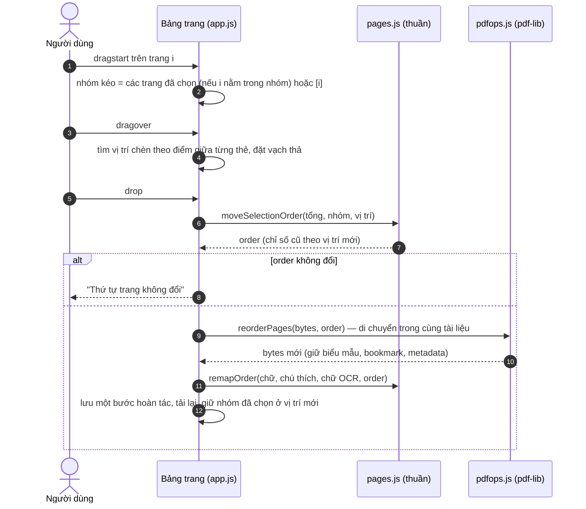

### 3.2. Công cụ nhanh cần tài liệu

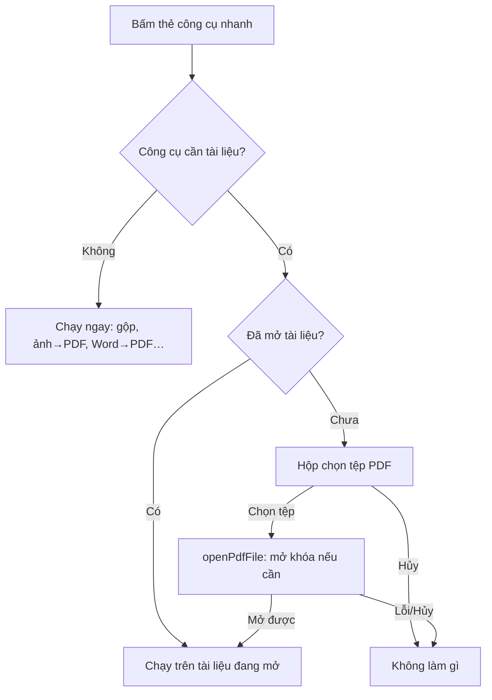

### 3.3. Font tiếng Việt khi xuất

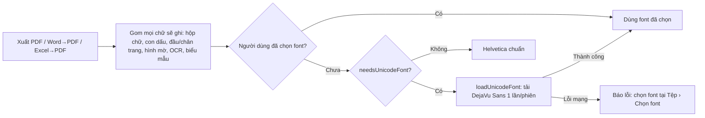

### 3.4. Cắt lề

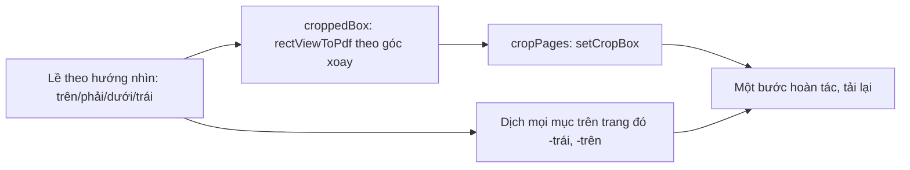

## 4. Module mới và thay đổi

| Tệp | Nội dung | Test |
|---|---|---|
| `src/pages.js` | `moveSelectionOrder`, `remapOrder`, `isIdentityOrder`, `splitPlan`, `paperName`, `pageSizeLabel` | `tests/pro.test.mjs` |
| `src/snap.js` (mới) | `snapLines`, `snapRect` | `tests/pro.test.mjs` |
| `src/crop.js` (mới) | `croppedBox`, `contentBounds`, `marginsFromBounds`, `mmToPt`, `ptToMm` | `tests/pro.test.mjs` |
| `src/fonts.js` (mới) | `isWinAnsi`, `needsUnicodeFont`, `toWinAnsi`, `loadUnicodeFont` | `tests/pro.test.mjs` |
| `src/textlayout.js` | `wrapText`, `fitText`; số trang tùy chọn cho TXT/HTML | `tests/pro.test.mjs` |
| `src/docsettings.js` | `pageStart`, `skipFirst`, `headerFooterContext` | `tests/pro.test.mjs` |
| `src/pdfops.js` | `reorderPages`, `cropPages`, `pageBoxes`, `mergePdfs` | thử trong trình duyệt |
| `src/converter.js` | Font Unicode, ngắt dòng theo độ rộng thật, Word giữ tiêu đề/danh sách/bảng, Excel mọi sheet + khổ ngang | thử trong trình duyệt |
| `src/quicktools.js` (mới) | `QUICK_TOOLS` (19 thẻ, 3 nhóm), `quickToolsGrid(onRun)` | thử trong trình duyệt |
| `src/libs.js` | URL font DejaVu Sans; SheetJS chuyển sang `cdn.sheetjs.com` | thử trong trình duyệt |
| `src/app.js` | Màn hình khởi động, hộp thoại Công cụ nhanh/Tách/Gộp/Cắt lề/Đánh số trang, tab Mục lục, `fontFor`/`exportTexts` cho mọi lần xuất, Gỡ mật khẩu, Đóng tài liệu; intent `quick:run` cho Ribbon | thử trong trình duyệt |

## 5. Rủi ro và cách phòng

- **RAM khi tài liệu lớn hoặc phóng to 400%**: `<pdf-canvas-view>` chỉ vẽ trang gần vùng nhìn, giải phóng trang ở xa và giới hạn điểm ảnh mỗi canvas. Cắt lề tự động đo từng trang ở tỉ lệ 0,75 rồi giải phóng canvas ngay.
- **Font tiếng Việt**: DejaVu Sans (~740 KB) chỉ tải khi chữ cần, một lần mỗi phiên, nhúng dạng subset nên tệp xuất nhỏ. Mất mạng thì báo rõ và gợi ý chọn font thủ công. Word→PDF/Excel→PDF khi không có font sẽ bỏ dấu thay vì lỗi.
- **Xoay nhiều trang**: các mục trên trang được gộp vào PDF trước khi xoay (như trước đây), chữ OCR của trang đó bị bỏ.
- **Cắt lề tự động**: chỉ đo nội dung đã vẽ trong PDF cộng các mục của trình soạn; trang trắng không bị cắt.
- **Tách "mỗi trang một tệp" với tài liệu hàng trăm trang**: mọi phần được tạo trong RAM rồi nén .zip; nên dùng "mỗi N trang" cho tài liệu rất lớn.

## 6. Kiểm thử

```bash
node --test tests/
python -m http.server 8000   # rồi mở http://localhost:8000
```

Kết quả lần thử này (Chrome, tệp thử tạo bằng pdf-lib/docx/SheetJS ngay trong trang; tệp tải về được chặn lại để đọc nội dung):

| # | Kịch bản | Kết quả |
|---|---|---|
| 1 | Màn hình khởi động, bấm **Tách PDF** khi chưa mở tệp → chọn tệp → mở → hộp thoại Tách | Đạt |
| 2 | Tách 4 trang "mỗi 3 trang" | .zip gồm `…-phan-1-trang-1-3.pdf` (3 trang) và `…-phan-2-trang-4.pdf` (1 trang) |
| 3 | Mục lục 2 mục (một mục tiếng Việt), bấm mục 2 | Nhảy tới trang 4 đúng độ cao đích XYZ |
| 4 | Đánh số "Trang {page} / {total}", bỏ trang bìa, xuất PDF | Trang 1 không số; trang 2–4: "Trang 1 / 3" … "Trang 3 / 3" (xem trước và tệp xuất giống nhau) |
| 5 | Con dấu "ĐÃ DUYỆT", xuất khi chưa chọn font | Font tự tải, chữ trích lại đúng "ĐÃ DUYỆT", tệp 8 KB nhờ nhúng subset |
| 6 | Cắt lề 20 mm cả 4 trang, rồi Ctrl+Z | Trang còn 481,9 × 728,5 pt; con dấu dịch đúng (−56,7; −56,7); hoàn tác trả lại |
| 7 | Gộp: tài liệu đang mở + 2 tệp + 1 tệp .txt, đổi thứ tự, "Gộp và mở" | 9 trang, tệp .txt bị từ chối có thông báo, giữ mục lục của tệp đầu |
| 8 | Word→PDF (tiêu đề, đoạn dài, danh sách, bảng tiếng Việt) | Giữ đủ chữ có dấu, ngắt dòng đúng, có dấu đầu dòng và bảng |
| 9 | Excel→PDF (8 cột × 60 dòng + sheet thứ hai) | Khổ ngang, lặp tiêu đề ở trang 2, số canh phải, sheet 2 ở trang riêng |
| 10 | PDF→Excel sau khi sửa URL SheetJS | 4 sheet, số đọc thành số |
| 11 | Đặt hạn chế quyền rồi **Gỡ mật khẩu** tệp đó | Tệp tải về mở được không cần mật khẩu |
| 12 | Đóng tài liệu, chủ đề tối | Về màn hình khởi động; giao diện tối đúng màu; không có lỗi console |

Thử tay thêm khi đổi giao diện: kéo-thả và chọn nhiều trang, Space/chuột giữa/Ctrl+lăn, bắt dính (giữ Ctrl để tắt), xem `src/components/`.


---

## 7. Hoàn thiện Bộ Tính Năng In Ấn Chuyên Nghiệp (Professional PDF Printing Suite)

Bản cập nhật nâng cấp toàn diện tính năng in ấn (`Ctrl+P` / nút "In" trên Ribbon, QAT, Backstage): chuyển từ cơ chế in iframe đơn giản sang Hộp thoại In hiện đại (White Theme), xem trước tương tác thời gian thực (Live Print Preview), hỗ trợ ghép trang N-up, khổ giấy, canh lề, chế độ in tiết kiệm mực (Grayscale) và đóng dấu bản in (Watermark).

### 7.1. Bản phác thảo giao diện (UI Mockup - White Theme)

```
+---------------------------------------------------------------------------------------------------------+
| [🖨] In tài liệu (Print Document)                                                                  [✕] |
+---------------------------------------------------------------------------------------------------------+
|                                                   |                                                     |
|  XEM TRƯỚC BẢN IN (PRINT PREVIEW)                 |  CẤU HÌNH IN (PRINT SETTINGS)                       |
|  --------------------------------                 |  ----------------------------                       |
|                                                   |                                                     |
|  +---------------------------------------------+  |  BẢN IN & SỐ LƯỢNG                                  |
|  | [N-UP: 2 TRANG/TỜ]      Khổ giấy: A4        |  |  Số bản sao: [ 1 ]                                  |
|  | +--------------------+ +------------------+ |  |                                                     |
|  | |                    | |                  | |  |  TRANG IN                                           |
|  | |   Trang 1          | |  Trang 2         | |  |  (•) Tất cả (12 trang)                              |
|  | |                    | |                  | |  |  ( ) Trang hiện tại (Trang 1)                       |
|  | |   [Nội dung PDF]   | |  [Nội dung PDF]  | |  |  ( ) Tùy chọn dải trang: [ 1-4, 7, 9-12          ] |
|  | |                    | |                  | |  |      Badge: Đã chọn 9 / 12 trang                    |
|  | |   \ BẢN NHÁP \     | |  \ BẢN NHÁP \    | |  |                                                     |
|  | +--------------------+ +------------------+ |  |  KHỔ GIẤY & BỐ CỤC                                  |
|  |                                             |  |  Khổ giấy: [ A4 (210 × 297 mm)               [▼] ]   |
|  | Tờ 1 / 6 (Chế độ Thang xám - Grayscale)     |  |  Chiều in: [ Tự động ] [ Chiều dọc ] [ Chiều ngang ]|
|  +---------------------------------------------+  |  Ghép trang: [ 1 trang ] [ 2 trang ] [ 4 trang (2x2)]|
|                                                   |                                                     |
|  Điều khiển xem trước:                            |  TỶ LỆ & CANH LỀ                                    |
|  [◀ Trước]  Tờ 1 / 6  [Sau ▶]      A4 · Dọc       |  Tỷ lệ: [ Vừa trang in (Fit)                 [▼] ]   |
|                                                   |  Lề giấy: [ Bình thường (10 mm)              [▼] ]   |
|                                                   |                                                     |
|                                                   |  NÂNG CAO                                           |
|                                                   |  [✓] In kèm Chú thích, Vẽ & Chữ ký                  |
|                                                   |  Chế độ màu: (•) Màu gốc  ( ) Thang xám (Grayscale)  |
|                                                   |  [✓] Đóng dấu mờ khi in (Watermark):                 |
|                                                   |      Nội dung: [ BẢN NHÁP                      ]    |
+---------------------------------------------------------------------------------------------------------+
|                                                                   [ Hủy bỏ ]    [ 🖨 In tài liệu (Enter) ] |
+---------------------------------------------------------------------------------------------------------+
```

### 7.2. Sơ đồ luồng xử lý (Workflow Diagram)

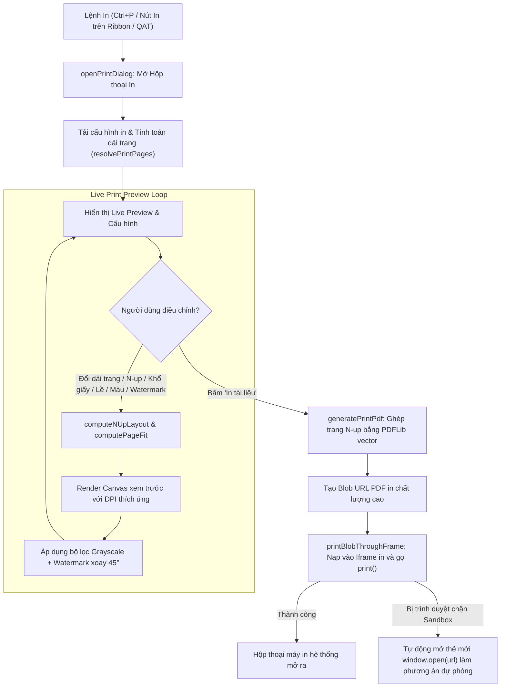

### 7.3. Các module và tính năng mới

| Tệp | Chức năng |
|---|---|
| `src/print.js` | Module in ấn chuyên nghiệp: `resolvePrintPages`, `validateCustomRange`, `getSheetDimensions`, `computeNUpLayout`, `computePageFit`, `sanitizePrintOptions`, `generatePrintPdf`, `renderLivePreview`, `openPrintDialog`. |
| `src/print.css` | Giao diện White Theme chuẩn Apple/Linear cho hộp thoại in, layout 2 cột (Preview bên trái, Settings bên phải), segmented buttons, icon N-up trực quan. |
| `src/app.js` | Tích hợp `openPrintDialog` vào lệnh in `printDocument()`, kết nối phím tắt `Ctrl+P`, Ribbon và QAT. |
| `tests/print.test.mjs` | Bộ unit test kiểm thử toàn diện logic dải trang, khổ giấy, ma trận N-up, tỷ lệ vừa trang và khử nhiễu cấu hình in. |

### 7.4. Kết quả kiểm thử

Tất cả 129 bài kiểm tra tự động (`tests/*.test.mjs`) đều vượt qua thành công:
- `resolvePrintPages`: Đạt (hỗ trợ tất cả, trang hiện tại, dải trang tùy chọn `1-3, 5`, tự động kẹp biên).
- `validateCustomRange`: Đạt (kiểm tra tính hợp lệ tức thì khi người dùng gõ phím).
- `computeNUpLayout`: Đạt (tính toán chính xác số tờ in, lưới trang và tọa độ slot cho 1, 2, 4, 6 trang/tờ).
- `computePageFit`: Đạt (giữ tỷ lệ khung hình, căn giữa ô in trong chế độ Fit, Actual size và Custom scale).
- `sanitizePrintOptions`: Đạt (làm sạch dữ liệu, hạn chế số bản in 1–99, an toàn trước giá trị bất thường).


---

## 8. Hoàn Thiện Tính Năng Tùy Chọn & Nâng Cao Chất Lượng PDF (Options & High-Fidelity PDF Engine)

Bản nâng cấp mở rộng hệ thống tùy chọn toàn diện (Preferences Dialog) và tối ưu hóa chất lượng hiển thị & xuất bản in tài liệu PDF:

### 8.1. Bản phác thảo giao diện (UI Mockup - White Theme)

```
+---------------------------------------------------------------------------------------------------------+
| [⚙] Tùy chọn & Cài đặt hệ thống (Preferences & Options)                                             [✕] |
+---------------------------------------------------------------------------------------------------------+
| DANH MỤC                    | NỘI DUNG CẤU HÌNH                                                         |
| --------------------------- | ------------------------------------------------------------------------- |
|                             |                                                                           |
| [⚡] Chất lượng & Kết xuất  | ĐỘ PHÂN GIẢI & KẾT XUẤT HIỂN THỊ                                          |
| [🔤] Soạn thảo & Phông chữ  | Độ phân giải màn hình:      [ Siêu nét (HiDPI 300 DPI)             [▼] ] |
| [📐] Hiển thị & Bắt dính    | Độ phân giải xuất bản in:   [ In ấn chuyên nghiệp (300 DPI)        [▼] ] |
| [🛡️] Bảo mật & Sao lưu      | [✓] Bật khử răng cưa văn bản & đối tượng vector (Anti-Aliasing)           |
|                             | [✓] Tự động làm mượt nét vẽ tự do & chữ ký (Bézier Stroke Smoothing)      |
|                             |                                                                           |
|                             | CHẤT LƯỢNG HÌNH ẢNH & CHE THÔNG TIN (REDACTION)                          |
|                             | Nén ảnh khi xuất:           [ Rất cao - 92% (Khuyên dùng)          [▼] ] |
|                             | Độ phân giải che nội dung:  [ 300 DPI (Sắc nét)                    [▼] ] |
|                             |                                                                           |
|                             | 💡 Mẹo: Thiết lập 300 DPI mang lại độ sắc nét hoàn hảo khi in hoặc gửi    |
|                             | hợp đồng, tự động giải phóng RAM ngay sau khi hoàn tất tác vụ xuất.       |
+---------------------------------------------------------------------------------------------------------+
| [ Khôi phục mặc định ]                                            [ Đóng ]      [ Lưu thay đổi (Ctrl+S) ]|
+---------------------------------------------------------------------------------------------------------+
```

### 8.2. Sơ đồ quy trình xử lý (Workflow Diagram)

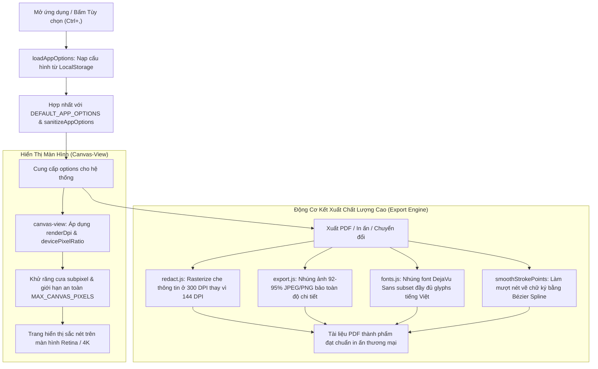

### 8.3. Các module và tính năng mới

| Tệp | Chức năng |
|---|---|
| `src/options.js` | Quản lý cấu hình hệ thống: `loadAppOptions`, `saveAppOptions`, `resetAppOptions`, `sanitizeAppOptions`, chuyển đổi đơn vị đo `unitConvert`, tỷ lệ DPI `getQualityScale`, làm mượt nét vẽ `smoothStrokePoints`, và hộp thoại `openOptionsDialog`. |
| `src/options.css` | Giao diện White Theme chuẩn Apple/Linear Settings: Sidebar tab bên trái, content panel bên phải, toggle switch mượt mà, callout hướng dẫn. |
| `src/redact.js` | Nâng cấp độ phân giải che nội dung (Redaction) từ 144 DPI lên 300 DPI chuẩn in ấn, tự động dọn dẹp canvas giải phóng bộ nhớ. |
| `src/export.js` | Tích hợp thuật toán nội suy Catmull-Rom Bézier spline cho nét vẽ tự do và chữ ký, mang lại đường cong thư pháp mượt mà trong PDF vector. |
| `src/components/canvas-view.js` | Kích hoạt `imageSmoothingQuality = 'high'` cho ngữ cảnh 2D, tối ưu độ sắc nét cho màn hình HiDPI / Retina. |
| `src/ribbon.js` & `src/app.js` | Tích hợp lệnh `options` vào Ribbon Xem, Ribbon Trang đầu, Backstage, phím tắt `Ctrl+,`. |
| `tests/options.test.mjs` | Bộ 6 unit test kiểm thử logic chuyển đổi đơn vị, thang tỷ lệ DPI, thuật toán làm mượt Bézier spline, làm sạch dữ liệu và lưu trữ an toàn. |

### 8.4. Kết quả kiểm thử

Tất cả **135 bài kiểm tra tự động** (`tests/*.test.mjs`) đều vượt qua 100%:
- `DEFAULT_APP_OPTIONS`: Cung cấp bộ cấu hình chất lượng cao (300 DPI Export, 150 DPI Render, 92% Image Quality, Anti-aliasing Bật).
- `unitConvert`: Chuyển đổi chính xác 1 in = 72 pt = 25.4 mm = 2.54 cm.
- `getQualityScale`: Tính toán tỷ lệ DPI chính xác và kẹp biên an toàn.
- `smoothStrokePoints`: Nội suy spline mượt mà cho cả dạng mảng `[x, y]` và đối tượng `{x, y}`.
- `sanitizeAppOptions`: Làm sạch dữ liệu, ngăn chặn giá trị bất thường gây crash ứng dụng.


---

## 9. Tích Hợp Tính Năng Đọc DOCX & Soạn Thảo Văn Bản Kiểu Word (Word Studio Mode)

Bản nâng cấp bổ sung chế độ **Word Studio Mode** toàn diện: cho phép mở đọc tệp `.docx` trực tiếp giữ nguyên bố cục định dạng, soạn thảo văn bản WYSIWYG trên trang A4 mô phỏng chuẩn MS Word, thanh Ribbon định dạng phong phú và xuất lưu hai chiều `.docx` / `PDF`.

### 9.1. Bản phác thảo giao diện (UI Mockup - White Theme)

```
+-------------------------------------------------------------------------------------------------------------------+
| [📘] Word Studio - [Bien-ban-cuoc-hop.docx]  Tệp  Chỉnh sửa  Chèn  Định dạng  Bố cục  Xem   [💾 Lưu DOCX] [🖨 In] [⬇ PDF] |
+-------------------------------------------------------------------------------------------------------------------+
| [ Times New Roman [▼] ] [ 13pt [▼] ] [ B ] [ I ] [ U ] [ S ] [ A [▼] ] [ 🖍 [▼] ] | [ ≡ ] [ ≢ ] [ ≣ ] [ ☷ ] | [ • List ] | [ 1. List ] | [ ⊞ Bảng ] [ 🖼 Ảnh ] [ ↶ ] [ ↷ ] |
+-------------------------------------------------------------------------------------------------------------------+
|                                                                                                                   |
|                  +-----------------------------------------------------------------------------+                  |
|                  |  CỘNG HÒA XÃ HỘI CHỦ NGHĨA VIỆT NAM                                         |  Trang A4 chuẩn  |
|                  |                   Độc lập - Tự do - Hạnh phúc                               |  210 x 297 mm    |
|                  |                                                                             |  Nền: #ffffff    |
|                  |                         BIÊN BẢN HỌP GIAO BAN                               |  Bóng: mềm 24px  |
|                  |                                                                             |  Lề: 20mm        |
|                  |  I. Thời gian và địa điểm:                                                  |                  |
|                  |  - Thời gian: 08 giờ 30 phút, ngày 24 tháng 10 năm 2026.                    |                  |
|                  |  - Địa điểm: Phòng họp tầng 3, Trụ sở công ty.                              |                  |
|                  |                                                                             |                  |
|                  |  II. Thành phần tham dự:                                                    |                  |
|                  |  +---------------------+-----------------------+-------------------------+  |                  |
|                  |  | STT | Họ và tên     | Chức vụ               | Trách nhiệm             |  |                  |
|                  |  +-----+---------------+-----------------------+-------------------------+  |                  |
|                  |  | 1   | Nguyễn Văn A  | Giám đốc điều hành    | Chủ trì cuộc họp        |  |                  |
|                  |  | 2   | Trần Thị B    | Trưởng phòng Kỹ thuật | Báo cáo tiến độ         |  |                  |
|                  |  +-----+---------------+-----------------------+-------------------------+  |                  |
|                  |                                                                             |                  |
|                  |  III. Nội dung cuộc họp:                                                    |                  |
|                  |  Nhất trí thông qua kế hoạch nâng cấp phần mềm và phân công nhiệm vụ...|    |  (Con trỏ soạn   |
|                  |                                                                             |   thảo nhấp nháy)|
|                  +-----------------------------------------------------------------------------+                  |
|                                                                                                                   |
+-------------------------------------------------------------------------------------------------------------------+
| Trang 1 / 2 · 425 từ · Tiếng Việt (Unicode dựng sẵn)                            [ 100% [▼] ] [ Vừa chiều rộng ]   |
+-------------------------------------------------------------------------------------------------------------------+
```

### 9.2. Sơ đồ quy trình xử lý (Workflow Diagram)

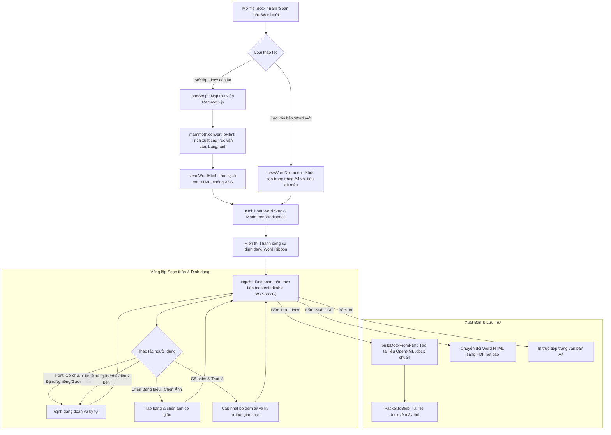

### 9.3. Các module và tính năng mới

| Tệp | Chức năng |
|---|---|
| `src/word-editor.js` | Module Word Studio: `cleanWordHtml`, `countWordsAndChars`, `extractTextRunsFromNode`, `parseTableMatrixFromHtml`, `buildDocxFromHtml`, và bộ điều khiển giao diện `createWordStudio`. |
| `src/word.css` | Giao diện White Theme chuẩn Office/Linear: Khung hiển thị trang A4 chân thực (`794px x 1123px`), thanh Ribbon công cụ định dạng, status bar đếm từ/ký tự. |
| `src/app.js` | Tích hợp Word Studio vào luồng khởi động (`showStart`), Ribbon Trang đầu, Backstage, mở file `.docx` trực tiếp từ nút Mở hoặc kéo thả. |
| `src/ribbon.js` | Bổ sung lệnh `newWordDoc` (Tạo văn bản Word mới) và `openWord` (Đọc Word). |
| `tests/word.test.mjs` | Bộ 4 unit test kiểm thử thuật toán đếm từ ngữ/ký tự, làm sạch mã HTML, trích xuất text run và trích xuất ma trận bảng biểu. |

### 9.4. Kết quả kiểm thử

Tất cả **139 bài kiểm tra tự động** (`tests/*.test.mjs`) đều vượt qua 100%:
- `countWordsAndChars`: Đạt (đếm chính xác từ ngữ, tổng ký tự, ký tự không khoảng trắng và số đoạn văn).
- `cleanWordHtml`: Đạt (loại bỏ thẻ nguy hiểm `<script>`, `<iframe>` và các event listener `onclick`, `onmouseover`).
- `extractTextRunsFromNode`: Đạt (trích xuất cấu trúc văn bản kèm kiểu dáng bold, italic, underline).
- `parseTableMatrixFromHtml`: Đạt (bóc tách bảng nhiều dòng/cột thành ma trận dữ liệu chính xác).


---

## 10. Bộ Công Cụ Đóng Dấu Mã QR, Barcode 128B, Con Dấu Chứng Từ & Số Nhảy Bates (Document Stamping Suite)

Bản nâng cấp bổ sung bộ công cụ số hóa chứng từ pháp lý và kế toán chạy hoàn toàn 100% tại trình duyệt (không phụ thuộc mạng CDN bên ngoài):
- **Tạo & Đóng dấu Mã QR (ISO/IEC 18004)**: Mã hóa UTF-8 đa phiên bản (Version 1–10) kèm mã sửa lỗi Reed-Solomon GF(256), quét được ngay bằng camera điện thoại / Zalo.
- **Tạo & Đóng dấu Mã vạch Barcode Code-128B (ISO/IEC 15417)**: Tự động tính toán checksum modulo-103 và dải vạch độ nét cao cho mã hồ sơ, số hóa đơn, kho vận.
- **Con dấu Chứng từ Pháp lý / Kế toán**: Tạo dấu mộc hộp chữ nhật 2 viền (`ĐÃ THU TIỀN`, `ĐÃ CHI TIỀN`, `SAO Y BẢN CHÍNH`, `ĐÃ PHÊ DUYỆT`...) và mộc tròn đối chiếu kèm ngày tháng và người ký.
- **Đóng số nhảy Bates Numbering chuyên biệt**: Cấu hình tiền tố, hậu tố, số bắt đầu, số chữ số đệm (`000001`), bỏ qua trang bìa và xem trước danh sách số nhảy theo thời gian thực.

### 10.1. Bản phác thảo giao diện (UI Mockup - White Theme)

```
+-------------------------------------------------------------------------------------------------------------+
| [⊞] Mã QR, Barcode & Con dấu Chứng từ                                                                   [✕] |
|     Tạo mã xác thực chuẩn ISO và đóng dấu hồ sơ 100% trên trình duyệt                                       |
+-------------------------------------------------------------------------------------------------------------+
|  [• Mã QR (2D)]  [ Barcode 128 (1D) ]  [ Con dấu chứng từ ]   |  XEM TRƯỚC TRỰC TIẾP                        |
|  +---------------------------------------------------------+  |  +---------------------------------------+  |
|  | Nội dung mã (URL, Mã số chứng từ, Văn bản):             |  |  |             +-----------+             |  |
|  | [ https://vetviral.com/verify?doc=hop-dong.pdf        ] |  |  |             | ▄▄▄▄▄ ▄▄▄ |             |  |
|  | Mẹo: Hỗ trợ biến {page}, {total}, {date}, {file}        |  |  |             | █   █ █▄█ |             |  |
|  |                                                         |  |  |             | █▄▄▄█ ▄ █ |             |  |
|  | Nhãn chú thích bên dưới:                                |  |  |             | ▄▄▄▄▄ █▄█ |             |  |
|  | [ Quét để xác thực                                    ] |  |  |             |  Quét xác |             |  |
|  |                                                         |  |  |             +-----------+             |  |
|  | Kích thước: [ Tiêu chuẩn (96 pt) [▼] ]  Màu: [ #0f172a ]|  |  +---------------------------------------+  |
|  | [✓] Hiển thị khung viền mảnh quanh mã                   |  |  Kích thước thực tế: 96 × 112 pt (300 DPI)  |
|  +---------------------------------------------------------+  |                                             |
|  | VỊ TRÍ & PHẠM VI ÁP DỤNG                                |  |  💡 Gợi ý sử dụng:                          |
|  | Phạm vi trang: [ Chỉ trang hiện tại (Trang 1)      [▼] ]|  |  • Chọn "Chỉ trang hiện tại" để kéo thả tự  |
|  | Vị trí đặt:    [ Góc dưới bên phải [▼] ] Lề: [ 24 ] pt  |  |    do tới vị trí bất kỳ trên trang.         |
|  +---------------------------------------------------------+  |  • Chọn "Đóng hàng loạt" để gắn đồng bộ.    |
+-------------------------------------------------------------------------------------------------------------+
|                                                                           [ Hủy ]   [ Chèn vào tài liệu ]   |
+-------------------------------------------------------------------------------------------------------------+
```

### 10.2. Sơ đồ quy trình xử lý (Workflow Diagram)

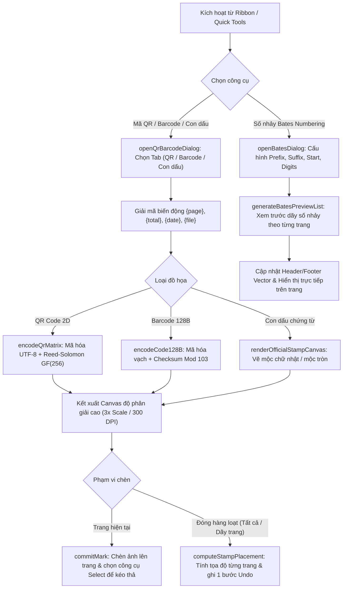

### 10.3. Các module và tính năng mới

| Tệp | Chức năng |
|---|---|
| `src/stamping.js` | Module số hóa chứng từ: `toBarcodeAscii`, `encodeCode128B`, `encodeQrMatrix`, `formatBatesItem`, `generateBatesPreviewList`, `computeStampPlacement`, `resolveCodeDynamicText`, `renderCodeCanvas`, `renderOfficialStampCanvas`, `openQrBarcodeDialog`, `openBatesDialog`. |
| `src/stamping.css` | Giao diện White Theme chuẩn Apple/Linear cho hộp thoại QR/Barcode/Con dấu và Bates Numbering. |
| `src/dom.js` | Bổ sung bộ icon vector `qrcode` và `barcode`. |
| `src/quicktools.js` & `src/ribbon.js` | Tích hợp thẻ công cụ nhanh và nút Ribbon `qrBarcode` (Mã QR/Barcode) & `batesStamp` (Số nhảy Bates) vào tab Chỉnh sửa, Ký & điền, và QAT. |
| `src/app.js` | Kết nối lệnh `qrBarcode` và `batesStamp`, hỗ trợ chèn đơn lẻ hoặc đóng dấu hàng loạt nhiều trang với 1 bước hoàn tác (`Ctrl+Z`). |
| `tests/stamping.test.mjs` | Bộ 5 unit test kiểm thử toàn diện thuật toán Barcode 128B, ma trận QR Code ISO 18004, chuỗi số nhảy Bates và tọa độ đóng dấu. |

### 10.4. Kết quả kiểm thử & Cảnh báo rủi ro

- **Kết quả Unit Test**: Toàn bộ **144/144 bài kiểm tra tự động** (`node --test tests/`) vượt qua 100%.
- **Lưu ý rủi ro & cách phòng tránh**:
  - *Giới hạn dung lượng mã QR*: Mã QR hỗ trợ tối đa khoảng 270 byte UTF-8 (Version 1–10, mức sửa lỗi L) để đảm bảo kích thước ô vuông rõ nét khi in trên giấy A4; nếu nhập văn bản quá dài hệ thống sẽ cảnh báo trực tiếp.
  - *Ký tự tiếng Việt trong Barcode 1D*: Chuẩn Code-128B chỉ hỗ trợ ký tự ASCII (32–126), nên `toBarcodeAscii` tự động chuyển chữ tiếng Việt có dấu sang không dấu (`Hồ sơ` -> `Ho so`) để máy đọc mã vạch luôn quét được.
  - *Đóng dấu hàng loạt nhiều trang*: Khi đóng mã QR có biến động `{page}` lên hàng chục trang, mỗi trang tạo một ảnh PNG riêng nhưng có kích thước nhỏ gọn (~2–4 KB/ảnh) nên không gây tràn bộ nhớ RAM.


---

## 11. Giai Đoạn 1: Sửa Chữ Gốc Trực Tiếp (Inline PDF Text Edit) & Mở Khóa Bộ Công Cụ Office Vector

Bản nâng cấp mở khóa trọn bộ 5 công cụ Office Vector ẩn sẵn trong kho mã nguồn lên thanh Ribbon và bổ sung công cụ **Sửa chữ gốc trực tiếp trên trang PDF (`editPdfText`)** theo cơ chế **Smart Mask + Unicode Overlay**:

### 11.1. Sơ đồ quy trình xử lý (Workflow Diagram)

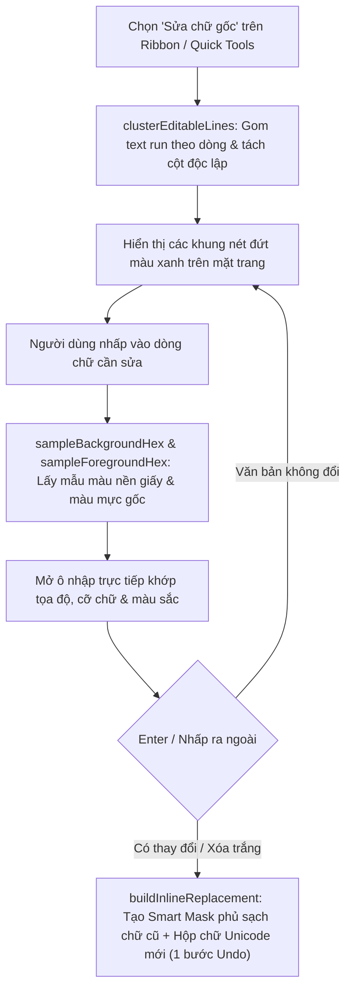

### 11.2. Các module và tính năng mới

| Tệp | Chức năng |
|---|---|
| `src/inline-edit.js` | Thuật toán phân cụm dòng/cột `clusterEditableLines`, lấy mẫu màu nền trung vị `sampleBackgroundHex`, màu mực tương phản `sampleForegroundHex`, tạo gói thay thế `buildInlineReplacement` và bộ điều khiển giao diện `createInlineTextEditor`. |
| `src/inline-edit.css` | Giao diện White Theme nhẹ nhàng cho khung chọn dòng gốc (`.inline-edit-slot`) và ô nhập trực tiếp (`.inline-edit-active`). |
| `src/ribbon.js` & `src/quicktools.js` | Đưa `tool:editPdfText` cùng toàn bộ 5 công cụ Office (`tool:shape`, `tool:connector`, `tool:richtext`, `insertTable`, `insertFormula`) lên thanh Ribbon (`Trang đầu`, `Chỉnh sửa`, `Chú thích`, `QAT`) và Màn hình chính. |
| `src/app.js` | Kết nối vòng đời `inlineEditor` với nạp/đóng tệp, chuyển đổi công cụ, chọn hộp chữ và hoàn tác `Ctrl+Z`. |
| `tests/inline-edit.test.mjs` | Bộ 5 unit test kiểm thử gom dòng, tách cột ngang, trích xuất màu nền/màu mực trên bộ đệm RGBA, Smart Mask và cấu hình Ribbon. |

### 11.3. Kết quả kiểm thử

- Toàn bộ **149/149 bài kiểm tra tự động** (`node --test tests/`) vượt qua 100%.


---

## 12. Giai Đoạn 2: Biểu Mẫu Tương Tác AcroForm 3-Trong-1 (`src/form-builder.js`)

Bản nâng cấp hoàn thiện hệ sinh thái biểu mẫu điện tử chuẩn PDF AcroForm với 3 trụ cột tích hợp đồng bộ: **Điền trực tiếp trên trang**, **Thiết kế kéo-thả 4 loại trường chuẩn** và **Tự dò dòng chấm / ô trống thông minh**:

### 12.1. Sơ đồ quy trình xử lý (Workflow Diagram)

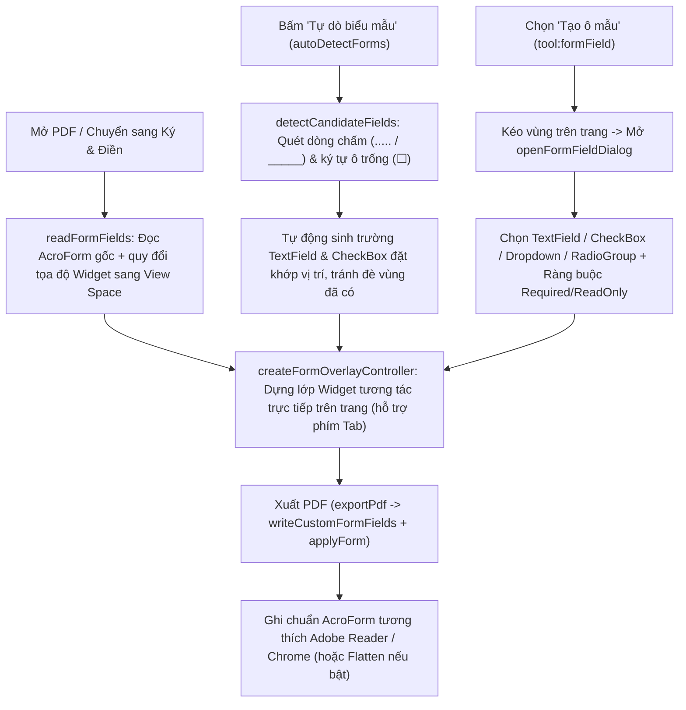

### 12.2. Các module và tính năng mới

| Tệp | Chức năng |
|---|---|
| `src/geometry.js` & `src/pdfops.js` | Bổ sung `pdfToView`, `rectPdfToView` đảo ngược mọi góc xoay `0°/90°/180°/270°`; nâng cấp `readFormFields` trích xuất tọa độ hiển thị của từng Widget AcroForm. |
| `src/form-builder.js` | Bộ xử lý AcroForm 3-trong-1: chuẩn hóa định danh tiếng Việt (`slugifyFieldName`, `uniqueFieldName`), tự động dò dòng chấm & ô trống (`detectCandidateFields`), sắp xếp thứ tự phím `Tab` (`sortWidgetsForTabOrder`), hộp thoại thiết kế trường (`openFormFieldDialog`) và lớp phủ điền/kéo-thả trực tiếp (`createFormOverlayController`). |
| `src/form-builder.css` | Giao diện White Theme tinh gọn cho các ô nhập trên mặt giấy PDF, tay nắm kéo/đổi cỡ và thanh công cụ Biểu mẫu. |
| `src/export.js` | Bổ sung `writeCustomFormFields` tạo mới `PDFTextField`, `PDFCheckBox`, `PDFDropdown`, `PDFRadioGroup` nhúng font Unicode tiếng Việt khi xuất. |
| `tests/form-builder.test.mjs` | Bộ 5 unit test kiểm thử toàn diện quy đổi tọa độ 4 chiều xoay, khử trùng tên trường tiếng Việt, thứ tự phím Tab và thuật toán tự dò dòng chấm/hộp kiểm. |

### 12.3. Kết quả kiểm thử

- Toàn bộ **154/154 bài kiểm tra tự động** (`node --test tests/`) vượt qua 100%.


---

## 13. Giai Đoạn 3: Đo Đạc Bản Vẽ Kỹ Thuật, Hiệu Chuẩn Tỷ Lệ & Kính Lúp (`src/measure.js`)

Bản nâng cấp trang bị bộ công cụ đo lường kỹ thuật chính xác dành cho bản vẽ kiến trúc, cơ khí, quy hoạch và tài liệu kỹ thuật:

### 13.1. Sơ đồ quy trình xử lý (Workflow Diagram)

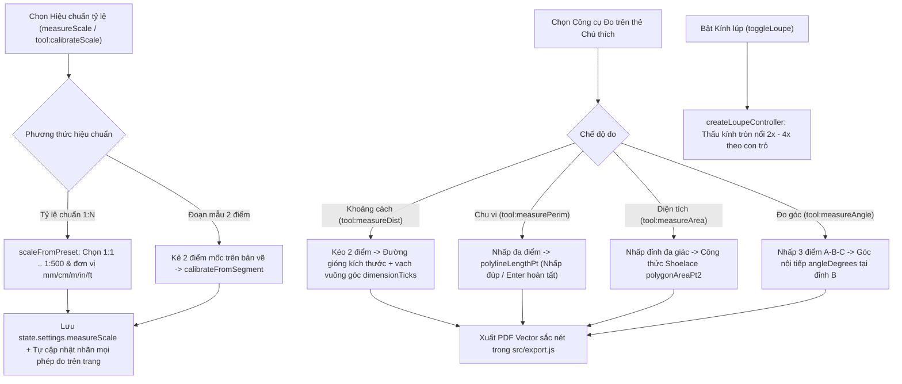

### 13.2. Các module và tính năng mới

| Tệp | Chức năng |
|---|---|
| `src/measure.js` | Bộ toán học đo lường & UI hiệu chuẩn: `scaleFromPreset`, `calibrateFromSegment`, `sanitizeMeasureScale`, `segmentDistancePt`, `polylineLengthPt`, `polygonAreaPt2` (Shoelace), `angleDegrees`, `formatMeasurementLabel`, `dimensionTicks`, `renderMeasureSvg`, `openScaleCalibrationDialog` và `createLoupeController`. |
| `src/measure.css` | Giao diện White Theme cho thấu kính phóng đại tròn nổi có tâm ngắm chữ thập (`2×`–`4×`) và nhãn đo kỹ thuật. |
| `src/marks.js` & `src/export.js` | Bổ sung kiểu mark `'measure'` hỗ trợ di chuyển, chọn xóa, hoàn tác `Ctrl+Z` và vẽ vector trực tiếp lên trang PDF khi xuất tệp. |
| `src/ribbon.js` & `src/quicktools.js` | Thêm nhóm **Đo đạc** trên thẻ `Chú thích`, nút **Kính lúp** trên thẻ `Xem` và thẻ công cụ nhanh trên màn hình bắt đầu. |
| `tests/measure.test.mjs` | Bộ 8 unit test kiểm thử tỷ lệ chuẩn `1:1`/`1:100`, hiệu chuẩn đoạn mẫu, diện tích đa giác Shoelace, góc 3 điểm và vạch kích thước vuông góc. |

### 13.3. Kết quả kiểm thử

- Toàn bộ **162/162 bài kiểm tra tự động** (`node --test tests/`) vượt qua 100%.
