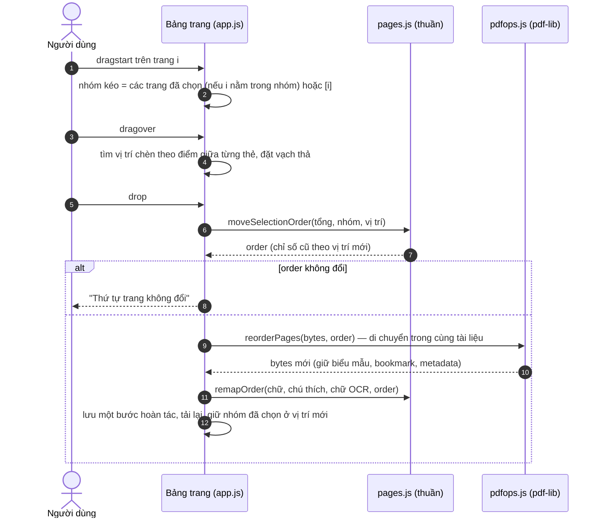
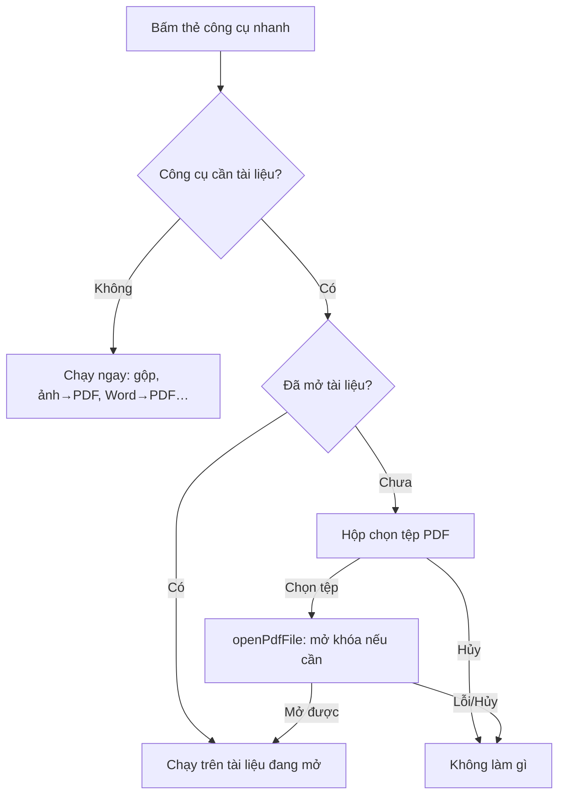
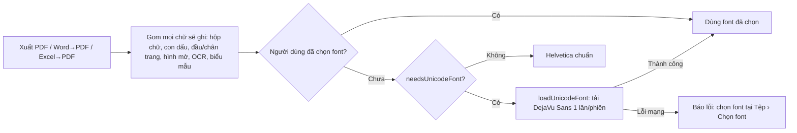
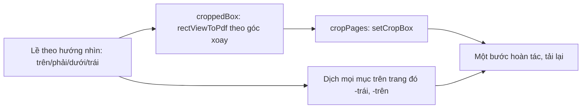

# Walkthrough: PDF Editor Pro — Công cụ nhanh & Tính năng nâng cao

Tài liệu này mô tả bản nâng cấp "Pro": thiết kế (mockup), luồng xử lý (Mermaid), các module mới, rủi ro và cách kiểm thử.

## 1. Phạm vi

| Nhóm | Tính năng | Ghi chú |
|---|---|---|
| Công cụ nhanh | Màn hình khởi động với lưới công cụ nhanh | Hiện khi chưa mở tệp; bấm một công cụ cần tệp sẽ hỏi chọn PDF rồi chạy luôn |
| | Hộp thoại **Công cụ nhanh** (Tệp › Công cụ nhanh, Trợ giúp, Ctrl+K) | Cùng lưới công cụ, dùng khi đang mở tài liệu |
| | Gộp nhiều PDF | Danh sách tệp, đổi thứ tự, đặt tài liệu đang mở lên đầu, gộp rồi mở hoặc tải về |
| | Tách PDF | Mỗi trang / mỗi N trang / theo phần tự chọn `1-3; 4-6; 7-`, nhiều phần đóng gói .zip |
| | Đánh số trang | Vị trí, mẫu, số bắt đầu, bỏ qua trang bìa |
| | Gỡ mật khẩu | Mở tệp có mật khẩu hoặc hạn chế quyền và tải bản không khóa |
| | Đóng tài liệu | Tệp › Đóng tài liệu, quay về màn hình khởi động |
| Nâng cao | Cắt lề trang | Lề cố định (mm) hoặc tự động theo nội dung từng trang, xem trước trực tiếp trên trang; các mục giữ đúng chỗ |
| | Mục lục (bookmark) | Tab **Mục lục** ở bảng bên phải, bấm để nhảy đến đúng trang và độ cao |
| | Font tiếng Việt tự động | Tự tải DejaVu Sans khi cần, chỉ lần đầu, cho xuất PDF (kể cả lớp chữ OCR), Word→PDF, Excel→PDF |
| | Word→PDF | Giữ tiêu đề, đoạn (ngắt dòng theo độ rộng thật), danh sách có dấu/đánh số, bảng |
| | Excel→PDF | Mọi sheet, độ rộng cột theo nội dung, bảng rộng tự xoay ngang, lặp dòng tiêu đề, số canh phải |
| Giao diện | White theme theo CLAUDE.md | `#ffffff`, `#f8fafc`, `#f4f4f5`, viền `#e4e4e7`, bo góc 8–12px; thêm tên token của kế hoạch (`--surface-card`…) |

Các tính năng sau có trong bản này nhưng do phiên làm việc song song xây trong `src/components/` (giai đoạn 3–4 của `pdf_editor_completion_plan.md`). Chúng dùng các hàm của đợt này: `moveSelectionOrder`, `remapOrder`, `isIdentityOrder` (`pages.js`), `reorderPages` (`pdfops.js`), `snapLines`/`snapRect` (`snap.js`).

- Kéo-thả sắp xếp trang, chọn nhiều trang (Ctrl/Shift), nút xoay/xóa nhanh trên từng hình thu nhỏ.
- Cuộn bằng Space+kéo, chuột giữa, công cụ Bàn tay (H), vuốt; Ctrl+lăn hoặc chụm hai ngón để phóng to tại con trỏ.
- Bắt dính khi kéo mục (giữ Ctrl để tắt), vẽ trang lười và giải phóng trang ở xa.

Sửa lỗi kèm theo:

- Word→PDF, Excel→PDF và con dấu "ĐÃ DUYỆT" báo lỗi WinAnsi khi chưa chọn font (Helvetica không có chữ tiếng Việt). Nay tự tải font, hoặc bỏ dấu thay vì lỗi khi mất mạng.
- `LIB_URLS.xlsx` trỏ tới `xlsx@0.20.2` trên jsDelivr, bản này không có trên npm (404), nên xuất Excel và Excel→PDF không chạy. Nay dùng CDN chính thức `cdn.sheetjs.com` cùng phiên bản.
- Trung tâm chuyển đổi: bỏ `alert()` (báo lỗi ngay trong hộp thoại), xuất Word theo đúng dải trang đã nhập, thả tệp vào ô kéo-thả không còn mở nhầm ở cửa sổ chính.

## 2. Mockup

### 2.1. Màn hình khởi động (chưa mở tệp)

```
+------------------------------------------------------------------------------------------------+
| PDF Editor [PRO]  Tệp  Sửa  Xem  Trang  Công cụ  Chuyển đổi  Bảo vệ  Trợ giúp   [Q Ctrl+K] [Đăng nhập] |
+------------------------------------------------------------------------------------------------+
| Đọc  Chú thích  Chỉnh sửa  Trang  Ký & điền  Chuyển đổi  Bảo vệ                         [📂][💾][🖨] |
+------------------------------------------------------------------------------------------------+
|                                                                                                |
|        PDF Editor Pro                                                                          |
|        Chỉnh sửa, chuyển đổi và bảo vệ PDF ngay trong trình duyệt. Tệp không rời khỏi máy.      |
|        +----------------------------------------------------------------------------------+    |
|        |  ⬆  Kéo thả tệp PDF vào đây       [ Mở PDF ]  [ Tài liệu trống ]                  |    |  nền #f8fafc
|        +----------------------------------------------------------------------------------+    |  viền đứt #e4e4e7
|                                                                                                |
|        SẮP XẾP & TỐI ƯU                                                                       |
|        +--------------+ +--------------+ +--------------+ +--------------+                    |
|        | [▦] Gộp PDF  | | [✂] Tách PDF | | [⇣] Nén PDF  | | [⇅] Sắp xếp  |   thẻ #ffffff       |
|        | Ghép nhiều   | | Theo dãy/N   | | Giảm dung    | | Kéo thả,     |   viền #e4e4e7      |
|        | tệp thành 1  | | trang        | | lượng        | | xoay, xóa    |   bo góc 12px       |
|        +--------------+ +--------------+ +--------------+ +--------------+   hover: viền xanh  |
|        CHUYỂN ĐỔI         PDF→Word · PDF→Excel · PDF→Ảnh · Ảnh→PDF · Word→PDF · Excel→PDF · OCR |
|        KÝ & BẢO VỆ        Ký tên · Hình mờ · Đặt mật khẩu · Gỡ mật khẩu · Che thông tin · ...  |
+------------------------------------------------------------------------------------------------+
```

### 2.2. Bảng trang: chọn nhiều, nút nhanh, kéo-thả

```
+----------------------+
| 3 trang đã chọn [×]  |  [+][⟲][⟳][🗑]   ← thao tác áp dụng cho nhóm đã chọn
+----------------------+
| +------------------+ |
| |      [⟲][⟳][⧉][🗑]|  ← hiện khi rê chuột / trang hiện tại (nền trắng, bo 6px)
| |   Trang 1        | |
| +------------------+ |
|          1           |
| ●━━━━━━━━━━━━━━━━━━● |  ← vạch thả 2px #2563eb, hai chấm tròn ở đầu mút
| +------------------+ |
| | ✓ Trang 2 (mờ)   | |  ← đang kéo: opacity .4; đã chọn: nền #eff6ff + dấu ✓
| +------------------+ |
+----------------------+
```

### 2.3. Smart snapping khi kéo mục

```
            ┆ (cyan #06b6d4, nét đứt — tâm trang)
   ┌────────┆────────┐
   │   ┌────┆────┐   │
   │   │ CON DẤU │   │  ← tâm mục trùng tâm trang → bắt dính, hiện đường gióng
   │   └────┆────┘   │
 ┄┄┼┄┄┄┄┄┄┄┄┄┄┄┄┄┄┄┄┼┄┄ (mép trên của mục khác)
   └─────────────────┘      Giữ Ctrl khi kéo để tắt bắt dính
```

### 2.4. Hộp thoại Cắt lề trang

```
+-------------------------------------------+
| Cắt lề trang                               |
| Áp dụng cho: [Trang hiện tại (2)      v]  |
| Cách cắt:   (•) Lề cố định  ( ) Tự động   |
|  Trên [10] mm  Phải [10] mm               |
|  Dưới [10] mm  Trái [10] mm               |
| [Đo lề trắng trang hiện tại]              |
| Xem trước: vùng bị cắt tô xám trên trang  |
|                       [Hủy]  [Cắt lề]     |
+-------------------------------------------+
```

## 3. Luồng xử lý

### 3.1. Kéo-thả sắp xếp trang (một hoặc nhiều trang)



### 3.2. Công cụ nhanh cần tài liệu



### 3.3. Font tiếng Việt khi xuất



### 3.4. Cắt lề



## 4. Module mới và thay đổi

| Tệp | Nội dung | Test |
|---|---|---|
| `src/pages.js` | `moveSelectionOrder`, `remapOrder`, `isIdentityOrder`, `splitPlan`, `paperName`, `pageSizeLabel` | `tests/pro.test.mjs` |
| `src/snap.js` (mới) | `snapLines`, `snapRect` | `tests/pro.test.mjs` |
| `src/crop.js` (mới) | `croppedBox`, `contentBounds`, `marginsFromBounds`, `mmToPt`, `ptToMm` | `tests/pro.test.mjs` |
| `src/fonts.js` (mới) | `isWinAnsi`, `needsUnicodeFont`, `toWinAnsi`, `loadUnicodeFont` | `tests/pro.test.mjs` |
| `src/textlayout.js` | `wrapText`, `fitText`; số trang tùy chọn cho TXT/HTML | `tests/pro.test.mjs` |
| `src/docsettings.js` | `pageStart`, `skipFirst`, `headerFooterContext` | `tests/pro.test.mjs` |
| `src/pdfops.js` | `reorderPages`, `cropPages`, `pageBoxes`, `mergePdfs` | thử trong trình duyệt |
| `src/converter.js` | Font Unicode, ngắt dòng theo độ rộng thật, Word giữ tiêu đề/danh sách/bảng, Excel mọi sheet + khổ ngang | thử trong trình duyệt |
| `src/quicktools.js` (mới) | `QUICK_TOOLS` (19 thẻ, 3 nhóm), `quickToolsGrid(onRun)` | thử trong trình duyệt |
| `src/libs.js` | URL font DejaVu Sans; SheetJS chuyển sang `cdn.sheetjs.com` | thử trong trình duyệt |
| `src/app.js` | Màn hình khởi động, hộp thoại Công cụ nhanh/Tách/Gộp/Cắt lề/Đánh số trang, tab Mục lục, `fontFor`/`exportTexts` cho mọi lần xuất, Gỡ mật khẩu, Đóng tài liệu; intent `quick:run` cho Ribbon | thử trong trình duyệt |

## 5. Rủi ro và cách phòng

- **RAM khi tài liệu lớn hoặc phóng to 400%**: `<pdf-canvas-view>` chỉ vẽ trang gần vùng nhìn, giải phóng trang ở xa và giới hạn điểm ảnh mỗi canvas. Cắt lề tự động đo từng trang ở tỉ lệ 0,75 rồi giải phóng canvas ngay.
- **Font tiếng Việt**: DejaVu Sans (~740 KB) chỉ tải khi chữ cần, một lần mỗi phiên, nhúng dạng subset nên tệp xuất nhỏ. Mất mạng thì báo rõ và gợi ý chọn font thủ công. Word→PDF/Excel→PDF khi không có font sẽ bỏ dấu thay vì lỗi.
- **Xoay nhiều trang**: các mục trên trang được gộp vào PDF trước khi xoay (như trước đây), chữ OCR của trang đó bị bỏ.
- **Cắt lề tự động**: chỉ đo nội dung đã vẽ trong PDF cộng các mục của trình soạn; trang trắng không bị cắt.
- **Tách "mỗi trang một tệp" với tài liệu hàng trăm trang**: mọi phần được tạo trong RAM rồi nén .zip; nên dùng "mỗi N trang" cho tài liệu rất lớn.

## 6. Kiểm thử

```bash
node --test tests/
python -m http.server 8000   # rồi mở http://localhost:8000
```

Kết quả lần thử này (Chrome, tệp thử tạo bằng pdf-lib/docx/SheetJS ngay trong trang; tệp tải về được chặn lại để đọc nội dung):

| # | Kịch bản | Kết quả |
|---|---|---|
| 1 | Màn hình khởi động, bấm **Tách PDF** khi chưa mở tệp → chọn tệp → mở → hộp thoại Tách | Đạt |
| 2 | Tách 4 trang "mỗi 3 trang" | .zip gồm `…-phan-1-trang-1-3.pdf` (3 trang) và `…-phan-2-trang-4.pdf` (1 trang) |
| 3 | Mục lục 2 mục (một mục tiếng Việt), bấm mục 2 | Nhảy tới trang 4 đúng độ cao đích XYZ |
| 4 | Đánh số "Trang {page} / {total}", bỏ trang bìa, xuất PDF | Trang 1 không số; trang 2–4: "Trang 1 / 3" … "Trang 3 / 3" (xem trước và tệp xuất giống nhau) |
| 5 | Con dấu "ĐÃ DUYỆT", xuất khi chưa chọn font | Font tự tải, chữ trích lại đúng "ĐÃ DUYỆT", tệp 8 KB nhờ nhúng subset |
| 6 | Cắt lề 20 mm cả 4 trang, rồi Ctrl+Z | Trang còn 481,9 × 728,5 pt; con dấu dịch đúng (−56,7; −56,7); hoàn tác trả lại |
| 7 | Gộp: tài liệu đang mở + 2 tệp + 1 tệp .txt, đổi thứ tự, "Gộp và mở" | 9 trang, tệp .txt bị từ chối có thông báo, giữ mục lục của tệp đầu |
| 8 | Word→PDF (tiêu đề, đoạn dài, danh sách, bảng tiếng Việt) | Giữ đủ chữ có dấu, ngắt dòng đúng, có dấu đầu dòng và bảng |
| 9 | Excel→PDF (8 cột × 60 dòng + sheet thứ hai) | Khổ ngang, lặp tiêu đề ở trang 2, số canh phải, sheet 2 ở trang riêng |
| 10 | PDF→Excel sau khi sửa URL SheetJS | 4 sheet, số đọc thành số |
| 11 | Đặt hạn chế quyền rồi **Gỡ mật khẩu** tệp đó | Tệp tải về mở được không cần mật khẩu |
| 12 | Đóng tài liệu, chủ đề tối | Về màn hình khởi động; giao diện tối đúng màu; không có lỗi console |

Thử tay thêm khi đổi giao diện: kéo-thả và chọn nhiều trang, Space/chuột giữa/Ctrl+lăn, bắt dính (giữ Ctrl để tắt), xem `src/components/`.
