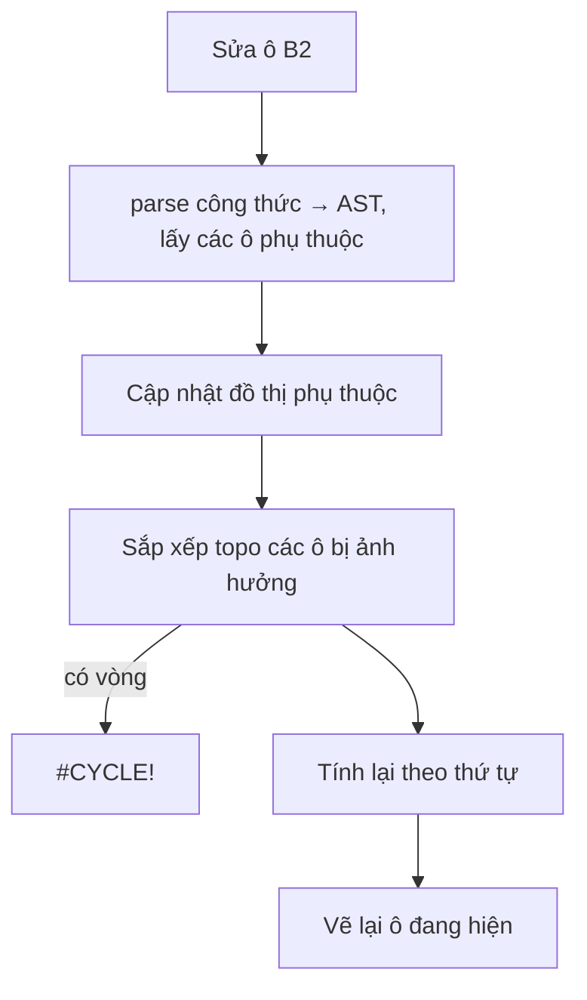

# Bộ ứng dụng văn phòng: Văn bản, Bảng tính, LaTeX, Trình chiếu

Giai đoạn tiếp theo sau Ribbon. Tham chiếu tính năng và định dạng: [Apache OpenOffice](https://github.com/apache/openoffice) (Writer `sw/`, Calc `sc/`, Math `starmath/`, Impress `sd/`). OpenOffice là ~10 triệu dòng C++ cho máy tính để bàn, không chạy được trong trình duyệt, nên chỉ dùng làm **tham chiếu thiết kế**: tên lệnh, bố cục ribbon, cú pháp công thức StarMath, tên hàm Calc, bố cục slide. Mã của ta viết bằng JS, chạy 100% tại máy người dùng.

## Giai đoạn

| Giai đoạn | Nội dung |
|---|---|
| 1 (đang làm) | Trình soạn thảo JS nhẹ: **Văn bản** (Writer), **Bảng tính** (Calc), **LaTeX + công thức** (Math), **Trình chiếu** (Impress). Thư viện nặng chỉ tải khi mở ứng dụng. |
| 2 | Tùy chọn "Mở bằng LibreOffice đầy đủ" (LibreOffice WebAssembly, ~100 MB, tải theo yêu cầu) cho tài liệu phức tạp. |

Chia việc: phiên `pdf-editor-oss-21` làm **công cụ chèn vào trang PDF** (`src/office/`: hình Draw, đường nối, công thức, bảng, khung chữ định dạng). Phiên này làm **các ứng dụng riêng** (`src/apps/`). Lõi công thức và lõi bảng tính viết một lần, hai bên dùng chung.

## Mockup

### Thanh chọn ứng dụng (trong thanh tiêu đề)

```
┌──────────────────────────────────────────────────────────────────────────────────────────┐
│ ▣ PDF Editor │ 📂 💾 🖨 ↶ ↷ ▾ │ [PDF] Văn bản  Bảng tính  LaTeX  Trình chiếu │ 🔍 Tìm lệnh  🔔 (A) │
└──────────────────────────────────────────────────────────────────────────────────────────┘
  Ribbon bên dưới đổi theo ứng dụng; tài liệu mỗi ứng dụng giữ nguyên khi chuyển qua lại.
```

### Văn bản (Writer)

```
│ [Tệp] Trang đầu  Chèn  Bố cục  Xem                                                        │
│ ┌──────┬─────────────────────────────┐┌────────────────┐┌───────────────────────┐          │
│ │ B I U S │ Cỡ [12▾] Màu [■] │ ≡ ≡ ≡ ≡ ││ • 1. ⇤ ⇥       ││ Tiêu đề 1 · 2 · 3 · Đoạn│          │
│ └─────────── Định dạng ──────┘└── Đoạn văn ───┘└────── Kiểu ──────────┘          │
├────────────────────────────────────────────────────────────────────────────────────────────┤
│  #f4f4f5           ┌──────────────── trang A4 trắng, đổ bóng ───────────────┐              │
│                    │ HỢP ĐỒNG THUÊ NHÀ                                       │              │
│                    │ Điều 1. …   công thức:  ∑ᵢ₌₁ⁿ xᵢ²   bảng 3×4 …          │              │
│                    └─────────────────────────────────────────────────────────┘              │
│ Trang 1/2 · 412 từ · Tự lưu 10:24                                           ⊖ 100% ⊕        │
```
Xuất: DOCX, PDF (mở tiếp trong trình sửa PDF), HTML. Mở: DOCX, HTML, TXT.

### Bảng tính (Calc)

```
│ [Tệp] Trang đầu  Chèn  Công thức  Dữ liệu  Xem                                            │
│ A1 [▾] │ fx │ =SUM(B2:B10)                                                                │
│    │  A        │  B       │  C      │  D   …                                              │
│  1 │ Mặt hàng  │ Số lượng │ Đơn giá │ Thành tiền                                         │
│  2 │ Giấy A4   │ 10       │ 65.000  │ =B2*C2      → 650.000                               │
│ …                                                                                          │
│ [Trang tính 1] [Trang tính 2] [+]          Tổng: 2.150.000 · Trung bình: … · Đếm: 5         │
```
Công thức kiểu Calc/Excel: `+ - * / ^ &`, so sánh, `SUM AVERAGE MIN MAX COUNT COUNTA IF IFERROR ROUND ABS SQRT POWER AND OR NOT CONCATENATE LEN UPPER LOWER TODAY`. Báo lỗi `#DIV/0!`, `#REF!`, `#NAME?`, `#VALUE!`, `#CYCLE!`. Xuất XLSX, CSV, PDF.

### LaTeX + công thức (Math)

```
│ [Tệp] Trang đầu  Chèn  Xem                                                                │
│ ┌────────── mã LaTeX ───────────┐ ┌──────────── xem trước (KaTeX) ─────────────┐          │
│ │ \section{Giới thiệu}           │ │ 1  Giới thiệu                               │          │
│ │ Phương trình $E=mc^2$ …        │ │ Phương trình E = mc² …                      │          │
│ │ \[ \int_0^1 x^2\,dx \]         │ │            ∫₀¹ x² dx                        │          │
│ └────────────────────────────────┘ └─────────────────────────────────────────────┘          │
  Bảng ký hiệu kiểu OpenOffice Math (toán tử, quan hệ, tập hợp, hàm, ngoặc, Hy Lạp);
  nhập được cú pháp StarMath ("sum from{i=1} to n x^2") và tự chuyển sang LaTeX.
```

### Trình chiếu (Impress)

```
│ [Tệp] Trang đầu  Chèn  Thiết kế  Trình chiếu  Xem                                         │
│ ┌──────┐ ┌──────────────────────────────── slide 16:9 ─────────────────────────────┐        │
│ │ 1 ▭  │ │   Tiêu đề bài trình bày                                                  │        │
│ │ 2 ▭  │ │   • Ý chính 1                                                           │        │
│ │ 3 ▭  │ │   • Công thức  a² + b² = c²                                              │        │
│ │ [+]  │ └──────────────────────────────────────────────────────────────────────────┘        │
│ └──────┘  Ghi chú người thuyết trình: …                                                    │
  F5: trình chiếu toàn màn hình; ←/→, Space, chạm/vuốt để chuyển slide; Esc để thoát.
```
Bố cục slide: Tiêu đề, Tiêu đề + nội dung, Hai cột, Trống. Chủ đề màu. Xuất PDF (mỗi slide một trang).

## Sơ đồ luồng

```mermaid
flowchart LR
    SW[Thanh chọn ứng dụng] -->|import() lần đầu| M{{app.mount(host, ctx)}}
    M --> R["ribbon.setContext({tabs, command, backstage})"]
    M --> D[(Tài liệu của app<br/>tự lưu localStorage)]
    D -->|Xuất| X[DOCX / XLSX / PDF / CSV / HTML]
    X -->|PDF| P[openBytes → trình sửa PDF]
    F[formula core<br/>StarMath → LaTeX → KaTeX] --> W[Văn bản] & L[LaTeX] & I[Trình chiếu] & O[Công cụ chèn PDF của 21]
    E[calc-engine<br/>công thức, tham chiếu, tính lại] --> C[Bảng tính] & O
```



## Rủi ro

- **Font tiếng Việt khi xuất PDF**: dùng cơ chế tự tải DejaVu Sans đã có (`fonts.js`).
- **Bộ nhớ**: bảng tính chỉ vẽ ô đang hiện; xuất slide ra ảnh ở 2× (không dùng 300 DPI mặc định).
- **Định dạng phức tạp** (.docx nhiều kiểu, .pptx có hiệu ứng): giai đoạn 1 chỉ giữ chữ, kiểu cơ bản, bảng, ảnh; tài liệu phức tạp chờ giai đoạn 2 (LibreOffice WASM).
- **Thư viện ngoài** (KaTeX, SheetJS, docx, mammoth): tải lười từ CDN, có phiên bản cố định.
