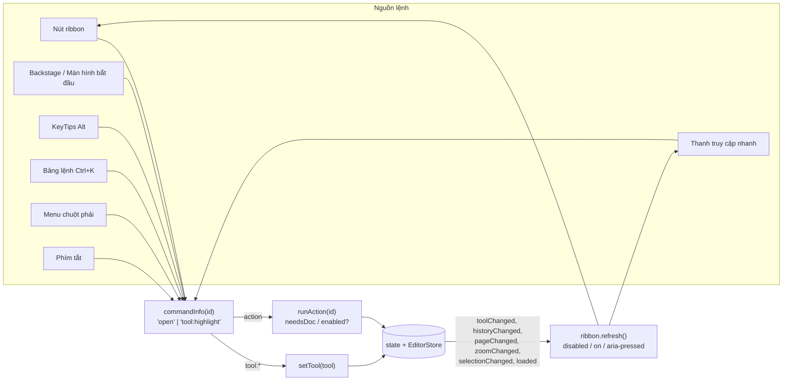
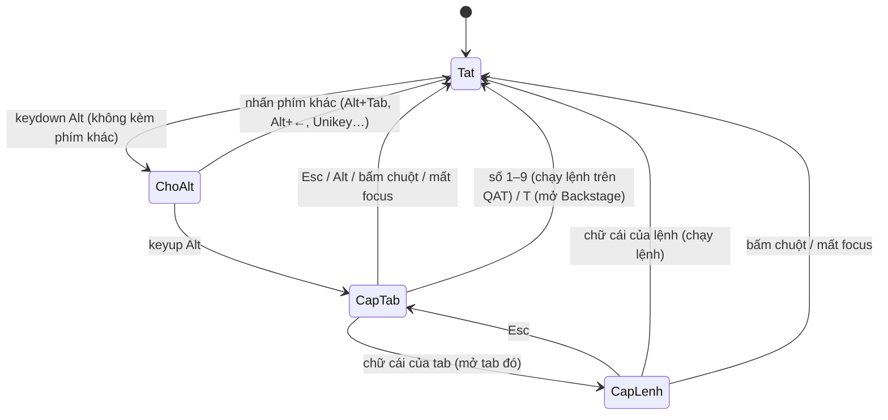
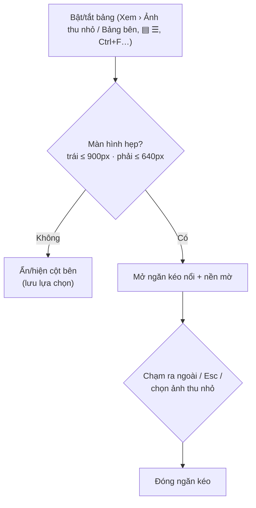

# Giao diện Ribbon & đa nền tảng

Tài liệu thiết kế (mockup, bảng màu, bố cục lệnh, sơ đồ luồng) cho việc thay thanh menu + thanh chế độ + thanh công cụ bằng **Ribbon** kiểu Office, kèm các tiện ích thao tác nhanh và hỗ trợ đa nền tảng (Windows, macOS, Linux, iPadOS/iOS, Android; chuột, bàn di và cảm ứng).

## 1. Mục tiêu

| Mục tiêu | Cách làm |
|---|---|
| Gom nhóm chức năng | 1 tab = 1 lĩnh vực, trong tab chia **nhóm có nhãn** (Tệp, Công cụ, Trang, …). Lệnh hay dùng là nút lớn, lệnh phụ là nút nhỏ xếp 3 nút/cột. |
| Thao tác nhanh | Thanh truy cập nhanh (QAT) tùy biến, **KeyTips** (nhấn Alt), Ctrl+K tìm lệnh, menu chuột phải trên trang/ảnh thu nhỏ/nút ribbon, màn hình bắt đầu. |
| Chuyên nghiệp | White theme (nền `#ffffff`, `#f8fafc`, `#f4f4f5`; viền 1px `#e4e4e7`; bo góc 8–12px), biểu tượng nét đồng nhất, trạng thái bật/tắt/vô hiệu rõ ràng, tooltip có phím tắt. |
| Đa nền tảng | Bố cục co giãn 3 mức (máy tính, máy tính bảng, điện thoại), vùng chạm ≥ 40px trên màn cảm ứng, phím tắt hiển thị đúng hệ điều hành (⌘ trên Mac/iPad), safe-area cho iPhone, bàn di/Ctrl+cuộn để thu phóng. |

## 2. Mockup

Dữ liệu mẫu: `Hop-dong-thue-nha.pdf`, 12 trang, 1,2 MB; đang ở trang 3, thu phóng 100%.

### 2.1 Máy tính, ribbon đầy đủ (≥ 1200px)

```
┌─────────────────────────────────────────────────────────────────────────────────────────────────┐
│ ▣ PDF Editor │ 📂 💾 🖨 │ ↶ ↷ │ ▾      Hop-dong-thue-nha.pdf      [🔍 Tìm lệnh…   Ctrl+K]  🔔² (A) An │ titlebar 40px  #f8fafc
├─────────────────────────────────────────────────────────────────────────────────────────────────┤
│ [Tệp]  Trang đầu  Chú thích  Chỉnh sửa  Trang  Ký & điền  Chuyển đổi  Bảo vệ  Xem           ⌃ │ tabs 36px  #ffffff
│        ‾‾‾‾‾‾‾‾‾ (gạch 2px màu của tab)                                                        │
├─────────────────────────────────────────────────────────────────────────────────────────────────┤
│ ┌──────┬──────┬────────────┐┌──────┬──────────────┬─────────────┐┌──────────────┐┌──────┬──────┐ │
│ │ 📂   │ 💾   │🖨 In        ││ ↖    │ T  Thêm chữ  │ ✎ Vẽ tự do  ││ ⟲ Xoay trái  ││ 🔍   │ ⌘ Tìm│ │ body 92px
│ │ Mở   │ Xuất │📄 Tài liệu…  ││ Chọn │ 🖍 Tô sáng    │ 🖼 Chèn ảnh  ││ ⟳ Xoay phải  ││ Tìm  │  lệnh│ │
│ │      │ PDF  │ⓘ Thuộc tính ││      │ 💬 Ghi chú    │ ✍ Chữ ký    ││ 🗑 Xóa trang  ││      │      │ │
│ ├──────┴──────┴────────────┤├──────┴──────────────┴─────────────┤├──────────────┤├──────┴──────┤ │
│ │           Tệp            ││              Công cụ               ││     Trang    ││   Tìm kiếm  │ │ nhãn nhóm 11px #6b6b73
│ └──────────────────────────┘└────────────────────────────────────┘└──────────────┘└─────────────┘ │
├─────────────────────────────────────────────────────────────────────────────────────────────────┤
│ ▌Định dạng · Tô sáng   Màu [■]   Độ mờ [────●──] 40%                                    [🗑 Xóa] │ thanh ngữ cảnh (khi có công cụ/mục chọn)
├────────────┬──────────────────────────────────────────────────────────────────┬─────────────────┤
│ Trang  ⟲⟳  │                                                                  │ Chú thích² Tìm…  │
│ ┌────────┐ │                 ┌──────────────────────────────┐                 │ ┌─────────────┐ │
│ │ ▒▒▒▒▒▒ │ │                 │                              │                 │ │● Tô sáng · 3│ │
│ │ ▒▒▒▒▒▒ │ │                 │        (trang PDF)           │                 │ │ Ghi chú…    │ │
│ └───1────┘ │                 │                              │                 │ └─────────────┘ │
│ ┌────────┐ │                 └──────────────────────────────┘                 │                 │
│ │▒▒(3)▒▒│ │                                                                  │                 │
├────────────┴──────────────────────────────────────────────────────────────────┴─────────────────┤
│ Đã mở Hop-dong-thue-nha.pdf (12 trang).          ◀ [ 3 ] / 12 ▶  │  ⊖ [100% ▾] ⊕  ↔  ▭          │ status 28px
└─────────────────────────────────────────────────────────────────────────────────────────────────┘
```

- **Tệp** là tab nhấn màu (nền `--accent`, chữ trắng), mở **Backstage** chứ không mở nhóm lệnh.
- Nút công cụ đang bật: nền `--selected` (#e6eefd), chữ/biểu tượng `--accent-text`. Lệnh cần tài liệu bị mờ (opacity .45) khi chưa mở PDF.
- `⌃` ở cuối hàng tab: chọn kiểu hiển thị ribbon (đầy đủ / gọn / chỉ hiện tab). Ctrl+F1 hoặc nhấp đúp tên tab để thu gọn/mở lại.
- Thu phóng và chuyển trang chuyển xuống thanh trạng thái (như Word), nên ribbon của mọi tab đều gọn.

### 2.2 Ribbon gọn (Simplified, một hàng ~44px)

```
│ [Tệp]  Trang đầu  Chú thích  Chỉnh sửa  Trang  Ký & điền  Chuyển đổi  Bảo vệ  Xem             ⌃ │
│ 📂 Mở  💾 Xuất PDF  🖨 In │ ↖ Chọn  T Thêm chữ  🖍 Tô sáng  💬 Ghi chú │ ⟲ ⟳ 🗑 │ 🔍 Tìm   ‹ › │
```

### 2.3 Chỉ hiện tab (thu gọn) – bấm tab thì ribbon bật ra dạng lớp nổi

```
│ [Tệp]  Trang đầu  [Chú thích]  Chỉnh sửa  …                                                 ⌄ │
│   ┌──────────────────────────────────────────────────────────────┐  ← lớp nổi, đổ bóng, tự đóng
│   │ ↖ Chọn │ 🖍 Tô sáng  U Gạch chân … │ 💬 Ghi chú  ⎔ Con dấu │ …    │    khi chạy lệnh / bấm ra ngoài / Esc
│   └──────────────────────────────────────────────────────────────┘
```

### 2.4 KeyTips (nhấn rồi thả Alt; Mac: ⌥)

```
│ ▣ PDF Editor │ 📂¹ 💾² 🖨³ │ ↶⁴ ↷⁵ │                                                             │
│ [Tệp T]  Trang đầu D  Chú thích C  Chỉnh sửa S  Trang R  Ký & điền K  Chuyển đổi H  Bảo vệ B  Xem X │
   → nhấn C: chuyển sang tab Chú thích, hiện chữ cái trên từng nút:  Chọn C · Tô sáng T · Gạch chân G …
   → nhấn T: bật công cụ Tô sáng, ẩn KeyTips.   Esc: lùi một cấp.   Bấm chuột: thoát.
```

### 2.5 Backstage (tab Tệp)

```
┌────────────────────┬─────────────────────────────────────────────────────────────────┐
│ ←  Quay lại         │  Tài liệu hiện tại                                              │
│                    │  ┌─────────────────────────────────────────────┐                │
│ 📂 Mở PDF…   Ctrl+O │  │ 📄 Hop-dong-thue-nha.pdf                     │                │
│ 📄 Tài liệu trống   │  │ 12 trang · 1,2 MB                            │                │
│ ───────────────── │  │ [ⓘ Thuộc tính…]  [T Chọn font .ttf…]          │                │
│ 💾 Xuất PDF  Ctrl+S │  └─────────────────────────────────────────────┘                │
│ 🖨 In…       Ctrl+P │  Tạo PDF từ        [🖼 Ảnh] [W Word] [X Excel]                     │
│ 🔄 Chuyển đổi…      │  Xuất thành        [PNG trang] [Ảnh HD] [Word] [Excel] [TXT] [HTML] │
│ ───────────────── │                    [Tách ảnh .zip]                               │
│ ⌨ Phím tắt          │  Giao diện         Chủ đề (•) Hệ thống ( ) Sáng ( ) Tối              │
│ 👤 Tài khoản        │                    Ribbon (•) Đầy đủ ( ) Gọn ( ) Chỉ hiện tab        │
└────────────────────┴─────────────────────────────────────────────────────────────────┘
  nền trái --accent-soft, phải --chrome; điện thoại: hai cột xếp chồng
```

### 2.6 Màn hình bắt đầu (chưa mở tệp)

```
                    ▣  PDF Editor
        Chỉnh sửa, ký, chuyển đổi và bảo vệ PDF ngay trong trình duyệt.
                 Tệp không rời khỏi máy của bạn.

          ┌──────────────────────────────────────────────────┐
          │      ⤓  Kéo thả tệp PDF vào đây  hoặc  [ Mở PDF ] │   (Ctrl+O)
          └──────────────────────────────────────────────────┘

   ┌───────────┐ ┌───────────┐ ┌───────────┐ ┌───────────┐ ┌───────────┐ ┌───────────┐
   │ 📄        │ │ 🖼         │ │ W         │ │ X         │ │ 🔄        │ │ ⌨         │
   │ Tài liệu  │ │ PDF từ ảnh │ │ Word→PDF  │ │ Excel→PDF │ │ Chuyển đổi │ │ Phím tắt  │
   └───────────┘ └───────────┘ └───────────┘ └───────────┘ └───────────┘ └───────────┘
          Mẹo: Ctrl+K tìm lệnh · Alt hiện phím truy cập · Ctrl+F1 thu gọn ribbon
```

### 2.7 Điện thoại (≤ 640px, ví dụ 390×844)

```
┌──────────────────────────────────┐
│ ▣  ↶ ↷ 💾        🔍  🔔  (A)      │ titlebar 44px + safe-area-inset-top
│ [Tệp] Trang đầu Chú thích Chỉnh… ›│ tabs cuộn ngang
│ 📂 💾 🖨 │ ↖ T 🖍 💬 ✎ │ ⟲ ⟳ 🗑 │ … ›│ ribbon gọn: chỉ biểu tượng 40×40, cuộn ngang
├──────────────────────────────────┤
│ ┌──────────────────────────────┐ │
│ │        (trang PDF,           │ │ 1 ngón: cuộn (công cụ Chọn)
│ │      vừa chiều rộng)         │ │ 2 ngón: chụm để thu phóng
│ └──────────────────────────────┘ │
├──────────────────────────────────┤
│ ▤  ◀ 3/12 ▶       ⊖ 100% ⊕     ☰ │ status 40px + safe-area-inset-bottom
└──────────────────────────────────┘
  ▤ mở ngăn kéo "Trang" (ảnh thu nhỏ) từ trái; ☰ mở ngăn kéo bảng bên (Chú thích/Tìm kiếm/Biểu mẫu/Tin) từ phải;
  nền mờ phía sau, chạm ra ngoài hoặc Esc để đóng. Ctrl+F / Tìm cũng tự mở ngăn kéo bên phải.
```

### 2.8 Menu chuột phải (và nhấn giữ trên Android)

```
 Trên trang:                        Trên nút ribbon:                    Trên ảnh thu nhỏ:
 ┌──────────────────────────────┐   ┌──────────────────────────────┐    ┌──────────────────────┐
 │ 🗑 Xóa mục đã chọn        Del │   │ ＋ Thêm vào truy cập nhanh    │    │ ⟲ Xoay trái          │
 │ ──────────────────────────── │   │ ──────────────────────────── │    │ ⟳ Xoay phải          │
 │ ⟲ Xoay trang sang trái        │   │ ⌃ Thu gọn ribbon      Ctrl+F1 │    │ ↑ Đưa lên trước      │
 │ ⟳ Xoay trang sang phải        │   └──────────────────────────────┘    │ ↓ Đưa ra sau         │
 │ ＋ Chèn trang trắng            │                                       │ ⧉ Nhân bản           │
 │ ⧉ Nhân bản trang              │                                       │ 🗑 Xóa trang          │
 │ 🗑 Xóa trang                  │                                       └──────────────────────┘
 │ ──────────────────────────── │
 │ ⊕ Phóng to   ⊖ Thu nhỏ  ▭ Vừa │
 │ 🔍 Tìm trong tài liệu  Ctrl+F │
 └──────────────────────────────┘
```

## 3. Bảng màu và kích thước

| Token | Sáng | Tối | Dùng cho |
|---|---|---|---|
| `--titlebar` | `#f8fafc` | `#1b1b1e` | thanh tiêu đề, thanh trạng thái |
| `--chrome` | `#ffffff` | `#26262a` | hàng tab, thân ribbon, bảng bên |
| `--pasteboard` | `#f4f4f5` | `#19191c` | nền quanh trang PDF |
| `--border` | `#e4e4e7` | `#3c3c43` | viền 1px |
| `--divider` | `#ececef` | `#333339` | vạch ngăn nhóm |
| `--accent` | `#1b63e0` | `#4b8bf5` | tab Tệp, nút chính, vạch tab đang chọn (theo màu tab) |
| `--selected` | `#e6eefd` | `#233a63` | nút đang bật |
| `--hover` | `#f4f4f5` | `#34343a` | rê chuột |
| Màu tab | Trang đầu xanh dương, Chú thích cam, Chỉnh sửa hồng, Trang xanh lá, Ký & điền tím, Chuyển đổi xanh ngọc, Bảo vệ đỏ, Xem xám | | vạch 2px dưới tab đang chọn |

Kích thước: nút lớn 56–76 × 66px (biểu tượng 24px, nhãn tối đa 2 dòng), nút nhỏ cao 22px (biểu tượng 16px), bo góc nút 6px, bảng/lớp nổi 10px, hộp thoại 12px. Trên màn cảm ứng (`pointer: coarse`) mọi nút ≥ 40px.

## 4. Bố cục tab và nhóm lệnh

| Tab | Nhóm (nút lớn · nút nhỏ) |
|---|---|
| **Tệp** | Backstage: Mở, Tài liệu trống, Xuất PDF, In, Chuyển đổi, Tạo PDF từ (ảnh, Word, Excel), Xuất thành (PNG, ảnh HD, Word, Excel, TXT, HTML, tách ảnh), Thuộc tính, Font, Phím tắt, Tài khoản, Chủ đề, Kiểu ribbon |
| **Trang đầu** | Tệp (Mở, Xuất PDF · In, Tài liệu mới, Thuộc tính) · Công cụ (Chọn · Thêm chữ, Tô sáng, Ghi chú, Vẽ tự do, Chèn ảnh, Chữ ký) · Trang (· Xoay trái, Xoay phải, Xóa trang) · Tìm kiếm (Tìm · Tìm lệnh) · Chuyển đổi (Chuyển đổi · Sang Word, Sang Excel, Giảm dung lượng) · Bảo vệ (Mật khẩu · Vùng che, Xóa thông tin ẩn) |
| **Chú thích** | Chọn · Đánh dấu văn bản (Tô sáng · Gạch chân, Gạch ngang, Gạch sóng) · Ghi chú (Ghi chú, Con dấu) · Hình vẽ (Vẽ tự do · Chữ nhật, Elip, Đường thẳng, Mũi tên) · Danh sách (Bảng chú thích · Xóa mục chọn) |
| **Chỉnh sửa** | Chọn · Chèn (Thêm chữ, Chèn ảnh · Liên kết) · Trình bày trang (Hình mờ, Đầu/chân trang) · Tài liệu (Thuộc tính · Font tiếng Việt, Xóa mục chọn) |
| **Trang** | Xoay (Xoay trái, Xoay phải) · Sắp xếp (· Lên trước, Ra sau) · Thêm & xóa (Trang trắng · Nhân bản, Xóa trang) · Tách & gộp (Trích xuất, Kết hợp PDF) · Xuất (· Trang thành PNG, Ảnh chất lượng cao) |
| **Ký & điền** | Chọn · Chữ ký · Điền chữ (Thêm chữ · Ngày hôm nay) · Ký hiệu (· Dấu tích, Dấu chéo, Dấu chấm) · Biểu mẫu (Điền biểu mẫu) |
| **Chuyển đổi** | Trung tâm (Trung tâm chuyển đổi) · Nhận dạng chữ (OCR · Hiện khung OCR) · PDF sang (· Word, Excel, Văn bản, Trang web) · Ảnh (Ảnh chất lượng cao · Trang thành PNG, Tách ảnh) · Tạo PDF từ (· Word, Excel, Ảnh) · Tối ưu (Giảm dung lượng) |
| **Bảo vệ** | Che thông tin (Vùng che · Tìm để che, Chọn) · Bảo mật (Đặt mật khẩu, Xóa thông tin ẩn) |
| **Xem** | Thu phóng (100% · Phóng to, Thu nhỏ, Vừa trang, Vừa chiều rộng) · Hiển thị (Ảnh thu nhỏ, Bảng bên) · Bảng bên (· Chú thích, Tìm kiếm, Biểu mẫu, Tin) · Ribbon (· Đầy đủ, Gọn, Chỉ hiện tab) · Chủ đề (· Theo hệ thống, Sáng, Tối) · Trợ giúp (· Phím tắt, Tìm lệnh) |

Đổi tab **không** tự đổi công cụ đang dùng (giống Office): công cụ chỉ đổi khi người dùng chọn nó hoặc nhấn Esc. Chọn một công cụ từ bảng lệnh/menu chuột phải thì ribbon chuyển sang tab có công cụ đó nếu tab hiện tại không có.

## 5. Sơ đồ luồng

### 5.1 Lệnh từ mọi nơi đi qua một đường



### 5.2 Máy trạng thái KeyTips



### 5.3 Bảng bên theo kích thước màn hình



## 6. Đa nền tảng

| Nền tảng / thiết bị | Hỗ trợ |
|---|---|
| Windows, Linux, ChromeOS | Phím tắt dạng `Ctrl+K`; Alt hiện KeyTips; cuộn chuột ngang trên ribbon; Ctrl+cuộn hoặc chụm bàn di để thu phóng trang. |
| macOS | Phím tắt hiển thị `⌘K`, `⇧⌘Z`, `⌥` (xử lý cả `metaKey`); chụm bàn di để thu phóng. |
| iPadOS / iOS | Vùng chạm ≥ 40px, safe-area (tai thỏ, thanh home), chiều cao `100dvh`; ⌘ cho bàn phím ngoài. |
| Android | Nhấn giữ mở menu ngữ cảnh; vùng chạm lớn; ngăn kéo cho bảng bên. |
| Trợ năng | `role="tablist"/"tab"/"toolbar"`, `aria-pressed`, phím mũi tên giữa các tab, viền focus rõ (`:focus-visible`), `prefers-reduced-motion`, Windows High Contrast (`forced-colors`). |

## 7. Rủi ro & lưu ý

- **Alt trên trình duyệt**: Chrome/Firefox trên Windows dùng Alt để đưa focus lên menu trình duyệt; trang gọi `preventDefault()` cho phím Alt đứng riêng để giữ focus. Alt kèm phím khác (Alt+Tab, Alt+←, Alt+Z của Unikey) không kích hoạt KeyTips.
- **Cảm ứng trên trang**: trang PDF đặt `touch-action: none` để vẽ được bằng ngón tay, nên cuộn một ngón ở công cụ Chọn và chụm hai ngón phải tự xử lý.
- **Hiệu năng**: ribbon chỉ dựng lại khi đổi tab; mọi thay đổi khác chỉ cập nhật trạng thái nút. Thu phóng bằng chụm/Ctrl+cuộn chỉ vẽ lại trang khi dừng tay.
- **Lưu tùy chọn**: QAT, kiểu ribbon và bảng bên lưu trong `localStorage` (bọc try/catch; trình duyệt chặn lưu trữ thì dùng mặc định).
