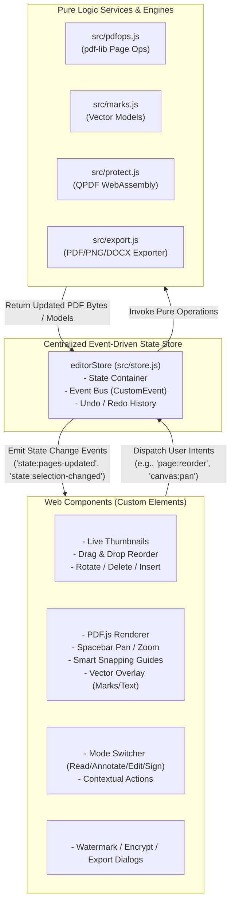
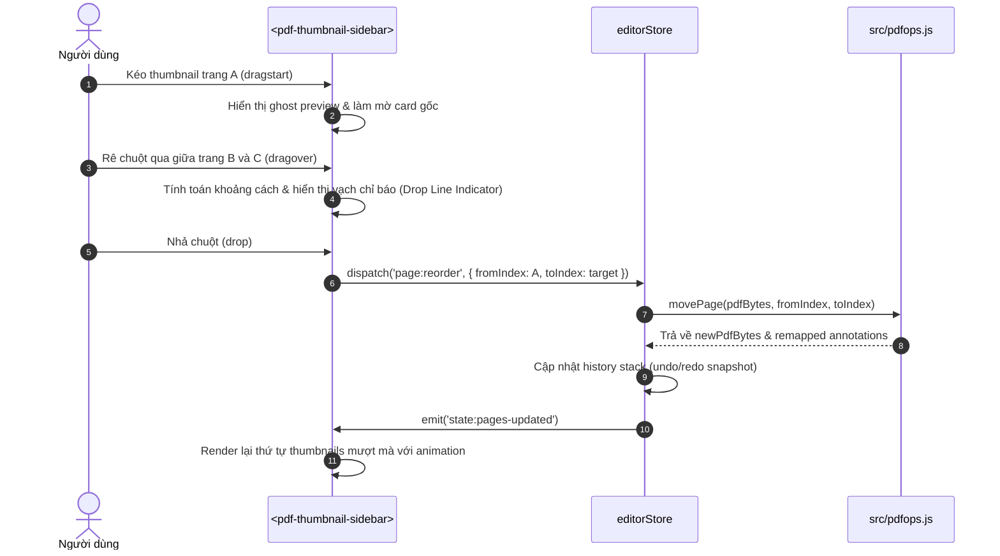

# Kế hoạch Hoàn thiện PDF Editor: Modern White Theme & Web Components Architecture

## 1. Tổng quan & Mục tiêu

Sau khi phân tích toàn bộ codebase hiện tại (`pdf-editor-oss`) và thống nhất định hướng qua phiên phỏng vấn (/grill-me):
- **Hiện trạng**: Ứng dụng SPA viết bằng Vanilla ES Modules (pdf.js, pdf-lib, tesseract.js, qpdf-wasm), 40/40 unit tests đang pass. UI đang tập trung nguyên khối trong `index.html` và `src/app.js` (~2,500 dòng).
- **Mục tiêu nâng cấp**:
  1. Chuẩn hóa kiến trúc UI sang **Custom Elements / Web Components** độc lập, dễ bảo trì và mở rộng.
  2. Thiết kế lại giao diện theo phong cách **White Theme cao cấp** (Apple/Linear aesthetic: viền 1px siêu mảnh `#e4e4e7`, nền sáng tinh khiết `#ffffff` & `#f8fafc`, bo góc mượt mà 8-12px, đổ bóng đa tầng nhẹ nhàng).
  3. Xây dựng cơ chế **State Store tập trung (`editorStore`)** theo mô hình Event-Driven.
  4. Nâng cấp 2 tính năng tương tác trọng tâm:
     - **Kéo - thả sắp xếp trang trực quan (Drag-and-Drop Thumbnail Reordering)** với vạch chỉ thị vị trí thả mượt mà.
     - **Tương tác Canvas nâng cao**: Kéo rê di chuyển (Pan qua phím Spacebar / chuột giữa) và Smart Snapping (căn chỉnh theo mép/tâm trang tự động).

---

## 2. Sơ đồ Kiến trúc & Luồng Xử lý (Workflow Diagrams)

### 2.1. Kiến trúc Tổng thể (Event-Driven Web Components)



### 2.2. Quy trình Kéo-Thả Sắp Xếp Trang (Thumbnail Drag-and-Drop Workflow)



---

## 3. Bản Phác Thảo Giao Diện (Visual Mockup - Modern White Theme)

Bản phác thảo mô phỏng tỷ lệ thực tế, cấu trúc component, mã màu và các điểm tương tác:

```
+--------------------------------------------------------------------------------------------------------------------+
|  [PDF Editor Pro]   Tệp   Sửa   Xem   Trang   Công cụ   Chuyển đổi   Bảo vệ   Trợ giúp             [Ctrl+K Lệnh...] [?] |
+--------------------------------------------------------------------------------------------------------------------+
|  [Đọc]   [Chú thích]   [Chỉnh sửa]   [Trang]   [Ký & Điền]   [Chuyển đổi]   [Bảo vệ]       | Q Tìm kiếm   Phóng to: 100% |
+--------------------------------------------------------------------------------------------------------------------+
|  [Con trỏ] [Ghi chú] [Tô sáng] [Gạch chân] [Hình vẽ v] [Chữ T] [Ảnh] [Con dấu] [Che vùng]  |  Nét: [2px v] Màu: [ #1b63e0 ]|
+----------------------+-------------------------------------------------------------------+-------------------------+
| TRANG (3)        [+] |                                                                   | CHÚ THÍCH (2)   TÌM KIẾM|
+----------------------+                       [ Smart Snap Guides ]                       +-------------------------+
| +------------------+ |                                 │                                 | [ Tô sáng - Trang 1   ] |
| | [Trang 1]        | |     ┌───────────────────────────┼───────────────────────────┐     | "Hợp đồng dịch vụ..."   |
| |                  | |     │                           │ (Center Snap Guide)       │     |                         |
| +------------------+ |     │                 CỘNG HÒA XÃ HỘI CHỦ NGHĨA             │     | [ Ghi chú - Trang 2   ] |
|                      |     │                       VIỆT NAM                        │     | "Kiểm tra điều khoản 4" |
| === Drop Indicator ===     │                                                       │     |                         |
|                      |     │   HỢP ĐỒNG DỊCH VỤ CÔNG NGHỆ THÔNG TIN                │     +-------------------------+
| +------------------+ |     │   Số: 104/2026/HĐ-CNTT                                │     | BIỂU MẪU                |
| | [Trang 2] (Drag) | |     │                                                       │     | Họ tên: [Nguyễn Văn A ] |
| | [Ghost Preview]  | |     │   Bên A: ...........................................  │     | Ngày ký: [16/10/2026  ] |
| +------------------+ |     │   Bên B: ...........................................  │     |                         |
|                      |     │                                                       │     | [ Điền xong & Khóa ]    |
| +------------------+ |     └───────────────────────────────────────────────────────┘     |                         |
| | [Trang 3]        | |                                                                   |                         |
| |                  | |     [ Con trỏ: Bàn tay di chuyển (Spacebar + Drag) ✋ ]           |                         |
+----------------------+-------------------------------------------------------------------+-------------------------+
| Sẵn sàng  •  Trang 1 / 3  •  Kích thước: 595.3 x 841.9 pt (A4)                                  | Phím tắt: Space+Kéo = Pan|
+--------------------------------------------------------------------------------------------------------------------+
```

### Bảng màu Modern White Theme (Design Tokens)

| Token Name | Hex Code | Ứng Dụng |
| :--- | :--- | :--- |
| `--surface-canvas` | `#f4f4f5` | Nền pasteboard chứa trang PDF, trung tính nhẹ giúp trang A4 nổi bật |
| `--surface-card` | `#ffffff` | Nền thanh công cụ, sidebars, modal dialogs, trang giấy trắng |
| `--surface-subtle` | `#f8fafc` | Nền thumbnail hover, input background, table header |
| `--border-subtle` | `#e4e4e7` | Đường kẻ 1px phân tách tinh xảo giữa các panels |
| `--border-focus` | `#2563eb` | Viền xanh khi focus hoặc khi phần tử được chọn (selection outline) |
| `--text-main` | `#0f172a` | Chữ chính (Slate-900), tương phản cao, dễ đọc |
| `--text-muted` | `#64748b` | Nhãn phụ, thông tin trang, placeholder (Slate-500) |
| `--accent-primary` | `#1d4ed8` | Nút hành động chính, tab active, con trỏ công cụ |
| `--drop-indicator` | `#2563eb` | Vạch chỉ báo vị trí thả (2px màu xanh kèm 2 chấm tròn đầu mút) |
| `--snap-guide` | `#06b6d4` | Đường gióng thông minh màu Cyan nét đứt khi căn thẳng hàng |

---

## 4. Kế hoạch Triển khai Từng bước Cuốn chiếu (Implementation Steps)

### Giai đoạn 1: Chuẩn bị Môi trường & Khởi tạo Rules
1. Khởi tạo Git repository (`git init`) để theo dõi phiên bản theo yêu cầu workflow.
2. Tạo file `CLAUDE.md` trong thư mục gốc dự án theo đúng quy chuẩn User Rules.

### Giai đoạn 2: Thiết kế `editorStore` (Event-Driven State Store)
1. Tạo module `src/store.js` chứa container trạng thái tập trung.
2. Triển khai cơ chế Subscribe/Emit Custom Events (`pdf:loaded`, `page:reorder`, `canvas:pan`, `selection:changed`).
3. Viết Unit tests cho `store.js` trong thư mục `tests/store.test.mjs` kiểm tra state transitions và event dispatching.

### Giai đoạn 3: Nâng cấp Design Tokens & Xây dựng `<pdf-thumbnail-sidebar>`
1. Nâng cấp CSS biến token trong `index.html` sang Modern White Theme.
2. Tạo Custom Element `PdfThumbnailSidebar` (`src/components/thumbnail-sidebar.js`):
   - Render danh sách thumbnail bất đồng bộ qua PDF.js canvas.
   - Hỗ trợ HTML5 Drag-and-Drop: kéo thả đổi vị trí trang với vạch hiển thị vị trí thả mượt mà.
   - Tích hợp nút xoay nhanh, xóa nhanh trên từng thẻ thumbnail.
3. Ghép nối component vào `index.html` và kết nối với `editorStore`.

### Giai đoạn 4: Xây dựng `<pdf-canvas-view>` (Pan & Smart Snapping)
1. Tạo Custom Element `PdfCanvasView` (`src/components/canvas-view.js`):
   - Di chuyển mượt mà: Giữ phím `Spacebar` hoặc bấm chuột giữa để kéo rê canvas (Pan tool).
   - Smart Snapping: Tự động bắt dính (snap) các đối tượng chú thích / text vào các đường căn lề trang (lề trái, lề phải, trục giữa x/y).
   - Hiển thị đường gióng căn lề (Snap guides) màu Cyan khi kéo đối tượng gần vị trí căn chuẩn.
2. Ghép nối và kiểm tra tương thích với lớp SVG annotations hiện tại.

### Giai đoạn 5: Tách `<pdf-toolbar>`, Hộp thoại & Kiểm thử Toàn diện
1. Hoàn thiện các thành phần còn lại: `<pdf-toolbar>`, nâng cấp giao diện các Dialogs (Export, Watermark, Protect).
2. Kiểm tra toàn bộ 40 test case hiện có + test mới, đảm bảo 100% pass và không làm gãy bất kỳ chức năng nào.
3. Review 2 lần, commit Git và cập nhật walkthrough tài liệu.

---

## 5. Đánh giá Rủi ro & Giải pháp Phòng ngừa (Risk & Mitigation)

> [!WARNING]
> **Rủi ro 1: Xung đột tọa độ khi bổ sung Canvas Panning & Zoom**
> - *Nguy cơ*: Lớp SVG Overlay (chứa các hình vẽ, highlight) và các Text Box có thể bị lệch tọa độ so với PDF Canvas bên dưới khi kéo rê hoặc phóng to.
> - *Giải pháp*: Tất cả tọa độ vẫn lưu trữ chuẩn hóa ở View Space (PDF points gốc top-left). Thao tác Pan chỉ thay đổi thuộc tính `scrollLeft`/`scrollTop` của container hoặc `transform: translate()` trên wrapper bọc ngoài cùng, giữ nguyên tỉ lệ 1:1 giữa canvas và overlay.

> [!WARNING]
> **Rủi ro 2: Hiệu năng kéo thả Thumbnail khi tài liệu có nhiều trang (>50 trang)**
> - *Nguy cơ*: Render lại toàn bộ 50 canvas thumbnails trong lúc drag-drop có thể gây giật lag (frame drop).
> - *Giải pháp*: Sử dụng Virtual DOM hoặc chỉ hoán đổi vị trí thẻ DOM (`insertBefore`) thay vì re-render lại nội dung canvas; chỉ sinh thumbnail khi thẻ xuất hiện trong tầm nhìn (IntersectionObserver).

---

## 6. Trạng thái thực hiện (17/10/2026)

| Giai đoạn | Trạng thái | Ghi chú |
| :--- | :--- | :--- |
| 1. Git + CLAUDE.md | Xong | |
| 2. `editorStore` | Xong | `src/store.js`, `tests/store.test.mjs`; lịch sử hoàn tác và sự kiện đi qua store. |
| 3. White theme + `<pdf-thumbnail-sidebar>` | Xong | Token màu trắng trong `index.html`; danh sách trang chọn nhiều (Ctrl/Shift), kéo thả với vạch chỉ báo, xoay/xóa nhanh, vẽ lười bằng IntersectionObserver, giữ hình khi sắp xếp. |
| 4. `<pdf-canvas-view>` | Xong | Space/chuột giữa/công cụ Bàn tay/vuốt để cuộn, Ctrl+lăn và chụm hai ngón để phóng to tại con trỏ, bắt dính vào mép/tâm trang, lề chữ và mục khác (`src/snap.js`), vẽ trang lười và giới hạn điểm ảnh mỗi canvas (rủi ro 1 và 2 đã xử lý). |
| 5. Toolbar, dialogs | Xong một phần | Thanh công cụ được thay bằng Ribbon (`src/ribbon.js`, làm riêng). Hộp thoại: tiêu đề có biểu tượng và nút đóng, giữ tiêu điểm trong hộp thoại, hình mờ có xem trước, mật khẩu có nút hiện/ẩn. |
